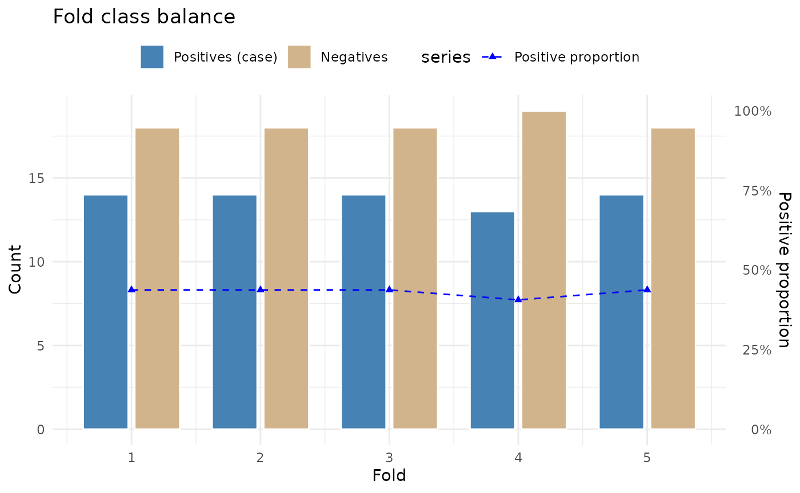
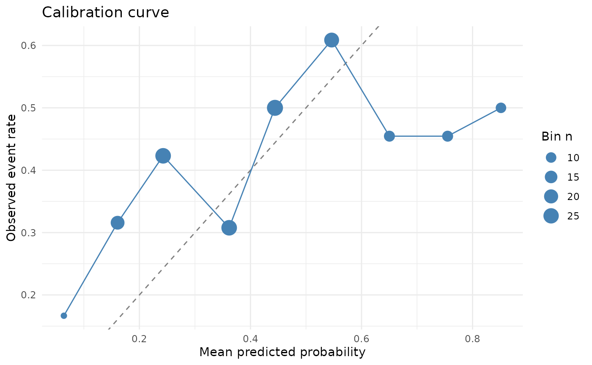
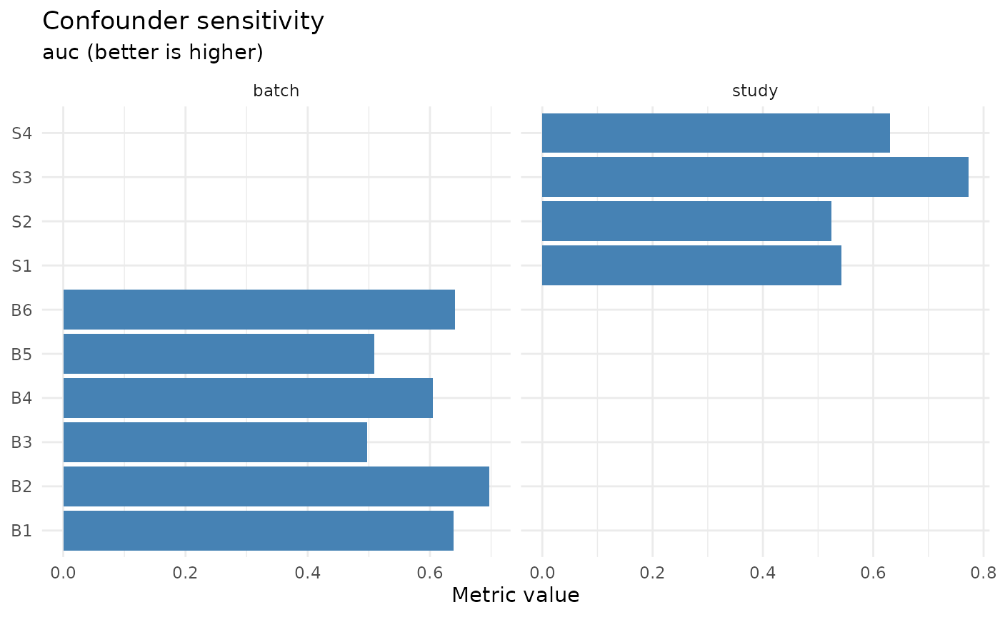
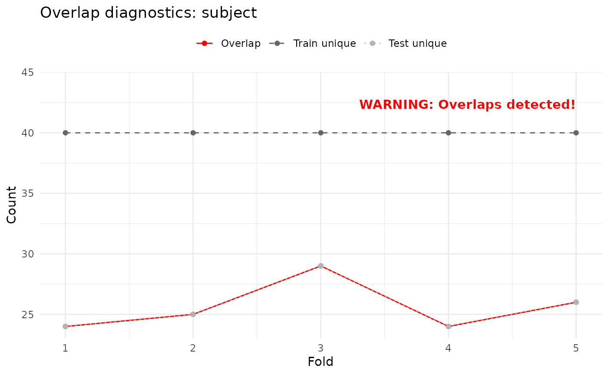
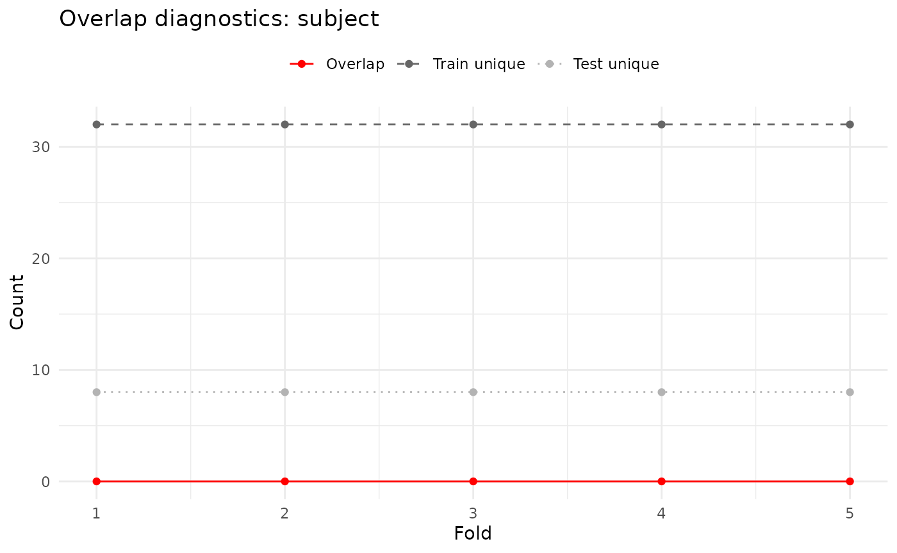
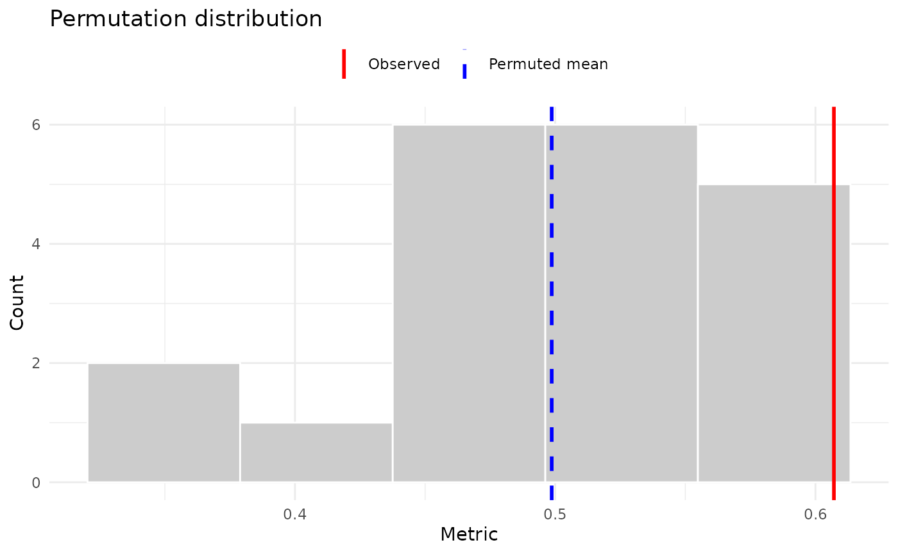
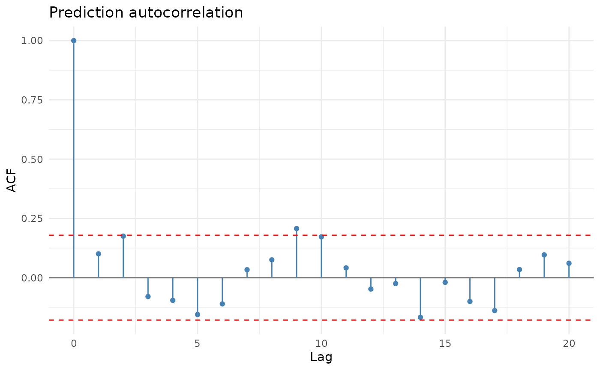

# bioLeak: Leakage-Aware Biomedical Modeling

## Why bioLeak

bioLeak is a leakage-aware modeling toolkit for biomedical and
machine-learning analyses. Its purpose is to prevent and diagnose
information leakage across resampling workflows where training and
evaluation data are not truly independent because samples share
subjects, batches, studies, or time.

Standard workflows are often insufficient. Random, row-wise
cross-validation assumes samples are independent. Global preprocessing
(imputation, scaling, feature selection) done before resampling lets
test-fold information shape the training process. These choices inflate
performance and can lead to incorrect biomarker discovery, misleading
clinical signals, or models that fail in deployment.

Data leakage means any direct or indirect use of evaluation data in
training or feature engineering. In biomedical data, leakage commonly
appears as:

- repeated measurements from the same patient split across folds
- batch or study effects that align with the outcome
- duplicates or near-duplicates across train and test
- time-series lookahead or random splits that use future information
- preprocessing that uses all samples instead of training-only
  statistics

bioLeak addresses these issues with leakage-aware splitting, guarded
preprocessing that is fit only on training data, and audit diagnostics
that surface overlaps, confounding, and duplicates.

## Guided workflow

The sections below walk through a leakage-aware workflow from data setup
to audits. Each step includes a leaky failure mode and a corrected
alternative.

### Example data

``` r

library(bioLeak)

set.seed(123)
n <- 160
subject <- rep(seq_len(40), each = 4)
batch <- sample(paste0("B", 1:6), n, replace = TRUE)
study <- sample(paste0("S", 1:4), n, replace = TRUE)
time <- seq_len(n)

x1 <- rnorm(n)
x2 <- rnorm(n)
x3 <- rnorm(n)
linpred <- 0.7 * x1 - 0.4 * x2 + 0.2 * x3 + rnorm(n, sd = 0.5)
p <- stats::plogis(linpred)
outcome <- factor(ifelse(runif(n) < p, "case", "control"),
                  levels = c("control", "case"))

df <- data.frame(
  subject = subject,
  batch = batch,
  study = study,
  time = time,
  outcome = outcome,
  x1 = x1,
  x2 = x2,
  x3 = x3
)

df_leaky <- within(df, {
  leak_subject <- ave(as.numeric(outcome == "case"), subject, FUN = mean)
  leak_batch <- ave(as.numeric(outcome == "case"), batch, FUN = mean)
  leak_global <- mean(as.numeric(outcome == "case"))
})

df_time <- df
df_time$leak_future <- c(as.numeric(df_time$outcome == "case")[-1], 0)
predictors <- c("x1", "x2", "x3")


# Example data (first 6 rows)
head(df)
#>   subject batch study time outcome          x1         x2          x3
#> 1       1    B3    S4    1 control  0.21444531  1.0149432 -0.09736927
#> 2       1    B6    S3    2    case -0.32468591 -1.9927485  0.21615254
#> 3       1    B3    S1    3    case  0.09458353 -0.4272793  0.88246516
#> 4       1    B2    S3    4 control -0.89536336  0.1166373  0.20559750
#> 5       2    B2    S4    5 control -1.31080153 -0.8932076 -0.61643584
#> 6       2    B6    S2    6    case  1.99721338  0.3339029 -0.73479925

# Outcome class counts
as.data.frame(table(df$outcome))
#>      Var1 Freq
#> 1 control   91
#> 2    case   69
```

The table preview displays the metadata columns (`subject`, `batch`,
`study`, `time`), the binary outcome, and three numeric predictors
(`x1`, `x2`, `x3`).

The class count table shows the baseline prevalence. Stratified splits
try to preserve these proportions (for grouped modes, stratification is
applied at the group level).

### Create leakage-aware splits with `make_split_plan()`

[`make_split_plan()`](https://selcukorkmaz.github.io/bioLeak/reference/make_split_plan.md)
is the foundation. It returns a `LeakSplits` object with explicit
train/test indices (or compact fold assignments) and metadata. For
data.frame inputs, a unique `row_id` column is added automatically, so
`group = "row_id"` is the explicit way to request sample-wise CV. It
assumes that the grouping columns you provide are complete and that
samples sharing a group must not cross folds. Grouped stratification
uses the majority class per group and is ignored for `study_loocv`,
`time_series`, and survival outcomes. Misuse to avoid:

- using `group = "row_id"` (sample-wise CV) when subjects repeat
- using the wrong grouping column (for example batch instead of subject)
- using time-series CV with unsorted or missing time values
- relying on stratification when the outcome is missing, single-class at
  the group level, or a time/event outcome
- assuming `time_series` will always return exactly `v` folds

**Leaky example: row-wise CV when subjects repeat**

``` r

leaky_splits <- make_split_plan(
  df,
  outcome = "outcome",
  mode = "subject_grouped",
  group = "row_id",
  v = 5,
  repeats = 1,
  stratify = TRUE
)

cat("Leaky splits summary (sample-wise CV):\n")
#> Leaky splits summary (sample-wise CV):
leaky_splits
#> LeakSplits object (mode = subject_grouped, v = 5, repeats = 1)
#> Outcome: outcome | Stratified: TRUE | Nested: FALSE
#> ------------------------------------------------------
#>   fold repeat_id train_n test_n
#> 1    1         1     128     32
#> 2    2         1     128     32
#> 3    3         1     128     32
#> 4    4         1     128     32
#> 5    5         1     128     32
#> ------------------------------------------------------
#> Total folds: 5 | Hash: a1d0d344b081f06779b77eae92b33c62
```

The printed `LeakSplits` summary reports the split mode, number of
folds, and fold-level training and test set sizes.

Because `group = "row_id"`, each sample is treated as its own group. As
a result, repeated samples from the same subject may appear in both the
training and test sets, which introduces information leakage.

**Leakage-safe alternative: group by subject**

``` r

safe_splits <- make_split_plan(
  df,
  outcome = "outcome",
  mode = "subject_grouped",
  group = "subject",
  v = 5,
  repeats = 1,
  stratify = TRUE,
  seed = 10
)

cat("Leakage-safe splits summary (subject-grouped CV):\n")
#> Leakage-safe splits summary (subject-grouped CV):
safe_splits
#> LeakSplits object (mode = subject_grouped, v = 5, repeats = 1)
#> Outcome: outcome | Stratified: TRUE | Nested: FALSE
#> ------------------------------------------------------
#>   fold repeat_id train_n test_n
#> 1    1         1     128     32
#> 2    2         1     128     32
#> 3    3         1     128     32
#> 4    4         1     128     32
#> 5    5         1     128     32
#> ------------------------------------------------------
#> Total folds: 5 | Hash: a6f3b679e2e99c1121cd253f61aff11e
```

Here, each subject is confined to a single fold. Test set sizes are
multiples of the number of samples per subject, confirming that subjects
were not split across folds.

The fold sizes remain comparable because `stratify = TRUE` balances
outcome proportions across folds while respecting subject-level
boundaries.

**Other leakage-aware modes**

``` r

batch_splits <- make_split_plan(
  df,
  outcome = "outcome",
  mode = "batch_blocked",
  batch = "batch",
  v = 4,
  stratify = TRUE
)

cat("Batch-blocked splits summary:\n")
#> Batch-blocked splits summary:
batch_splits
#> LeakSplits object (mode = batch_blocked, v = 4, repeats = 1)
#> Outcome: outcome | Stratified: TRUE | Nested: FALSE
#> ------------------------------------------------------
#>   fold repeat_id train_n test_n
#> 1    1         1     110     50
#> 2    2         1     138     22
#> 3    3         1     123     37
#> 4    4         1     109     51
#> ------------------------------------------------------
#> Total folds: 4 | Hash: b7ebf13db4083a991dfb65089a488556

study_splits <- make_split_plan(
  df,
  outcome = "outcome",
  mode = "study_loocv",
  study = "study"
)

cat("Study leave-one-out splits summary:\n")
#> Study leave-one-out splits summary:
study_splits
#> LeakSplits object (mode = study_loocv, v = 5, repeats = 1)
#> Outcome: outcome | Stratified: FALSE | Nested: FALSE
#> ------------------------------------------------------
#>   fold repeat_id train_n test_n
#> 1    1         1      96     64
#> 2    2         1     121     39
#> 3    3         1     131     29
#> 4    4         1     132     28
#> ------------------------------------------------------
#> Total folds: 4 | Hash: 51ebad5a2ade97fc502f662d7b1c9804

time_splits <- make_split_plan(
  df,
  outcome = "outcome",
  mode = "time_series",
  time = "time",
  v = 4,
  horizon = 2
)

cat("Time-series splits summary:\n")
#> Time-series splits summary:
time_splits
#> LeakSplits object (mode = time_series, v = 4, repeats = 1)
#> Outcome: outcome | Stratified: FALSE | Nested: FALSE
#> ------------------------------------------------------
#>   fold repeat_id train_n test_n
#> 1    2         1      39     40
#> 2    3         1      79     40
#> 3    4         1     119     40
#> ------------------------------------------------------
#> Total folds: 3 | Hash: dbde2d11033db6b03c4578feffd553d0

nested_splits <- make_split_plan(
  df,
  outcome = "outcome",
  mode = "subject_grouped",
  group = "subject",
  v = 3,
  nested = TRUE,
  stratify = TRUE
)

cat("Nested CV splits summary:\n")
#> Nested CV splits summary:
nested_splits
#> LeakSplits object (mode = subject_grouped, v = 3, repeats = 1)
#> Outcome: outcome | Stratified: TRUE | Nested: TRUE
#> ------------------------------------------------------
#>   fold repeat_id train_n test_n
#> 1    1         1     108     52
#> 2    2         1     108     52
#> 3    3         1     104     56
#> ------------------------------------------------------
#> Total folds: 3 | Hash: d2859da2248aea1f4d40dc451094702b
```

**RNG seed lineage**

bioLeak uses offset-based seeding so that every sub-operation gets a
deterministic, distinct seed without requiring isolated RNG streams:

| Function | Base seed | Per-unit offset |
|----|----|----|
| [`make_split_plan()`](https://selcukorkmaz.github.io/bioLeak/reference/make_split_plan.md) | `set.seed(seed)` | repeats: `seed + 1000 * r`; nested: `seed + 1` |
| [`fit_resample()`](https://selcukorkmaz.github.io/bioLeak/reference/fit_resample.md) | `set.seed(seed)` | per-fold: `seed + fold_id` |
| [`audit_leakage()`](https://selcukorkmaz.github.io/bioLeak/reference/audit_leakage.md) | `set.seed(seed)` | per-permutation: `seed + b` |

These are **not** isolated RNG streams but simple offsets. Collisions do
not occur for practical parameter values (e.g., `repeats < 1000`,
`v < 1000`). Always set an explicit `seed` argument for reproducibility;
strict mode warns when `seed` is `NULL` or `NA`.

Each summary reports the number of folds and the fold sizes for the
corresponding split strategy.

- **Batch & Study:** The test set sizes vary because batches/studies are
  not evenly sized. `study_loocv` uses one study per fold, so `v` and
  `repeats` are ignored.

- **Time series:** The training set size increases across folds while
  the test set size follows the block size. Early blocks with no prior
  training data (or too-small test windows) are skipped, so you may see
  fewer than `v` folds.

**Combined (N-axis) mode**

When leakage can occur along multiple axes simultaneously (for example,
both subject and batch), `mode = "combined"` handles multi-axis
constraint splitting. The first element in `constraints` is the
**primary fold driver** (determines which groups go to test); subsequent
elements are **exclusion constraints** (training samples sharing
constraint-axis levels with the test set are removed).

``` r

# For combined mode, constraint-axis levels should not span all folds.
# Here each subject belongs to exactly one site, so site exclusion only
# removes training samples from the same site as the test subjects.
df_comb <- df
df_comb$site <- paste0("site", rep(1:8, each = 5)[df_comb$subject])

combined_splits <- make_split_plan(
  df_comb,
  outcome = "outcome",
  mode = "combined",
  constraints = list(
    list(type = "subject", col = "subject"),
    list(type = "batch",   col = "site")
  ),
  v = 4,
  stratify = TRUE,
  seed = 42
)

cat("Combined (N-axis) splits summary:\n")
#> Combined (N-axis) splits summary:
combined_splits
#> LeakSplits object (mode = combined, v = 4, repeats = 1)
#> Outcome: outcome | Stratified: TRUE | Nested: FALSE
#> ------------------------------------------------------
#>   fold repeat_id train_n test_n
#> 1    1         1     140     20
#> 2    2         1     120     40
#> 3    3         1     120     40
#> 4    4         1     100     60
#> ------------------------------------------------------
#> Total folds: 4 | Hash: a065b9e85e204119fcca3fd19c112015
```

The fold sizes may be smaller than single-axis modes because training
samples are excluded whenever their site (or any constraint-axis level)
also appears in the test set. You can add more than two axes by
appending additional elements to `constraints`.

The legacy `primary_axis`/`secondary_axis` parameters are still accepted
for backward compatibility but `constraints` supersedes them and
supports arbitrary numbers of axes.

``` r

# Verify zero overlap on all constraint axes
overlap_result <- check_split_overlap(combined_splits)
overlap_result
#>   fold repeat_id     col n_overlap pass
#> 1    1         1 subject         0 TRUE
#> 2    1         1    site         0 TRUE
#> 3    2         1 subject         0 TRUE
#> 4    2         1    site         0 TRUE
#> 5    3         1 subject         0 TRUE
#> 6    3         1    site         0 TRUE
#> 7    4         1 subject         0 TRUE
#> 8    4         1    site         0 TRUE
```

**Assumptions and intent by mode**

- `subject_grouped`: keeps all samples from a subject together
- `batch_blocked`: keeps batches/centers together (leave-one-group-out
  when `v` is at least the number of batches; otherwise multiple batches
  per fold)
- `study_loocv`: holds out each study in turn for external validation
- `time_series`: rolling-origin splits with an optional horizon to
  prevent lookahead
- `combined`: primary axis drives fold assignment; all additional
  constraint axes are enforced as exclusion constraints on the training
  set

Use `repeats` for repeated CV in grouped/batch modes (it is ignored for
`study_loocv` and `time_series`), `stratify = TRUE` to balance outcome
proportions at the group level when applicable, and `nested = TRUE` to
attach inner folds (one repeat). For large datasets, `progress = TRUE`
reports progress; storing explicit indices can be memory intensive.

### Validating splits with `check_split_overlap()`

[`check_split_overlap()`](https://selcukorkmaz.github.io/bioLeak/reference/check_split_overlap.md)
verifies that no grouping-column levels appear in both the training and
test sets of any fold. It returns a data.frame with one row per
fold-column combination showing the overlap count and a pass/fail flag.

``` r

# Run on the subject-grouped splits from earlier
overlap_safe <- check_split_overlap(safe_splits)
overlap_safe
#>   fold repeat_id     col n_overlap pass
#> 1    1         1 subject         0 TRUE
#> 2    2         1 subject         0 TRUE
#> 3    3         1 subject         0 TRUE
#> 4    4         1 subject         0 TRUE
#> 5    5         1 subject         0 TRUE
```

When `cols` is not supplied, the function auto-infers the relevant
columns from the split mode (e.g., `subject` for `subject_grouped`, all
constraint axes for `combined`). By default `stop_on_fail = TRUE`, so
the function raises a `bioLeak_overlap_error` when any overlap is
detected. Set `stop_on_fail = FALSE` to return the results without
stopping.

When strict mode is active (`options(bioLeak.strict = TRUE)`),
[`make_split_plan()`](https://selcukorkmaz.github.io/bioLeak/reference/make_split_plan.md)
automatically runs
[`check_split_overlap()`](https://selcukorkmaz.github.io/bioLeak/reference/check_split_overlap.md)
after building non-compact splits, so you do not need to call it
manually.

### Scalability

**Handling Large Datasets (Compact Mode)**

For large datasets (e.g., $`N > 50,000`$) with many repeats, storing
explicit integer indices for every fold can consume gigabytes of memory.
Use `compact = TRUE` to store a lightweight vector of fold assignments
instead.
[`fit_resample()`](https://selcukorkmaz.github.io/bioLeak/reference/fit_resample.md)
will automatically reconstruct the indices on the fly. Compact mode is
not supported when `nested = TRUE` (it falls back to full indices). For
`time_series` compact splits, the time column must be present in the
stored split metadata so folds can be reconstructed.

``` r

# Efficient storage for large N
big_splits <- make_split_plan(
  df,
  outcome = "outcome",
  mode = "subject_grouped",
  group = "subject",
  v = 5,
  compact = TRUE  # <--- Saves memory
)

cat("Compact-mode splits summary:\n")
#> Compact-mode splits summary:
big_splits
#> LeakSplits object (mode = subject_grouped, v = 5, repeats = 1)
#> Outcome: outcome | Stratified: FALSE | Nested: FALSE
#> ------------------------------------------------------
#>   fold repeat_id train_n test_n
#> 1    1         1     128     32
#> 2    2         1     128     32
#> 3    3         1     128     32
#> 4    4         1     128     32
#> 5    5         1     128     32
#> ------------------------------------------------------
#> Total folds: 5 | Hash: ee2866b7282066cda850ea9995f43c10
cat(sprintf("Compact storage enabled: %s\n", big_splits@info$compact))
#> Compact storage enabled: TRUE
```

The summary is identical to a regular split, but the underlying storage
is a compact fold-assignment vector. Use the `compact` flag to confirm
the memory- saving mode is active.

### Strict leakage mode

Setting `options(bioLeak.strict = TRUE)` activates a global safety
switch that tightens validation across the entire workflow. In strict
mode:

1.  **Trained recipe/workflow detection escalates to an error.**
    Normally, passing a pre-trained recipe or workflow to
    [`fit_resample()`](https://selcukorkmaz.github.io/bioLeak/reference/fit_resample.md)
    or
    [`tune_resample()`](https://selcukorkmaz.github.io/bioLeak/reference/tune_resample.md)
    produces a warning. In strict mode, it raises an error so
    fold-global leakage cannot proceed silently.

2.  **Seed warnings.** When `seed` is `NULL` or `NA` in
    [`make_split_plan()`](https://selcukorkmaz.github.io/bioLeak/reference/make_split_plan.md),
    [`fit_resample()`](https://selcukorkmaz.github.io/bioLeak/reference/fit_resample.md),
    or
    [`tune_resample()`](https://selcukorkmaz.github.io/bioLeak/reference/tune_resample.md),
    strict mode emits a `bioLeak_validation_warning` reminding you to
    set an explicit seed for reproducibility.

3.  **Combined + nested warning.** Using `nested = TRUE` with
    `mode = "combined"` may produce empty inner folds; strict mode warns
    about this before proceeding.

4.  **Automatic overlap check.** After building non-compact splits,
    [`make_split_plan()`](https://selcukorkmaz.github.io/bioLeak/reference/make_split_plan.md)
    auto-runs
    [`check_split_overlap()`](https://selcukorkmaz.github.io/bioLeak/reference/check_split_overlap.md)
    to verify that no grouping-column levels cross fold boundaries.

``` r

# Enable strict mode temporarily
withr::with_options(list(bioLeak.strict = TRUE), {
  strict_splits <- make_split_plan(
    df,
    outcome = "outcome",
    mode = "subject_grouped",
    group = "subject",
    v = 5,
    stratify = TRUE,
    seed = 42
  )
  cat("Strict mode splits completed without error.\n")
})
#> Strict mode splits completed without error.
```

``` r

# Strict mode catches a pre-trained recipe
if (requireNamespace("recipes", quietly = TRUE)) {
  rec <- recipes::recipe(outcome ~ ., data = df[, c("outcome", predictors)]) |>
    recipes::step_normalize(recipes::all_numeric_predictors()) |>
    recipes::prep(training = df[, c("outcome", predictors)])

  withr::with_options(list(bioLeak.strict = TRUE), {
    tryCatch(
      fit_resample(
        df, outcome = "outcome",
        splits = safe_splits,
        learner = "glmnet",
        preprocess = rec
      ),
      error = function(e) cat("Strict mode error:", conditionMessage(e), "\n")
    )
  })
}
#> Strict mode error: fit_resample: received a trained recipe. Pass an untrained recipe to avoid fold-global leakage.
```

Strict mode is off by default. Use
[`withr::with_options()`](https://withr.r-lib.org/reference/with_options.html)
for temporary activation or set `options(bioLeak.strict = TRUE)` in your
`.Rprofile` for project-wide enforcement.

### Guarded preprocessing and imputation

`bioLeak` uses guarded preprocessing to prevent leakage from global
imputation, scaling, and feature selection. The low-level API is:

- [`guard_fit()`](https://selcukorkmaz.github.io/bioLeak/reference/guard_fit.md)
  to fit preprocessing on training data only
- [`predict()`](https://rdrr.io/r/stats/predict.html) (dispatching to
  [`predict.GuardFit()`](https://selcukorkmaz.github.io/bioLeak/reference/predict.GuardFit.md))
  to apply the trained guard to new data; the legacy alias
  [`predict_guard()`](https://selcukorkmaz.github.io/bioLeak/reference/predict.GuardFit.md)
  is also kept for backward compatibility
- [`guard_ensure_levels()`](https://selcukorkmaz.github.io/bioLeak/reference/guard_ensure_levels.md)
  to align factor levels across train/test
- [`impute_guarded()`](https://selcukorkmaz.github.io/bioLeak/reference/impute_guarded.md)
  as a convenience wrapper for leakage-safe imputation

[`guard_fit()`](https://selcukorkmaz.github.io/bioLeak/reference/guard_fit.md)
fits a pipeline that can winsorize, impute, normalize, filter, and
select features. It one-hot encodes non-numeric columns and carries
factor levels forward to new data. Assumptions and misuse to avoid:

- `fs = "ttest"` requires a binary outcome with enough samples per class
- `fs = "lasso"` requires `glmnet`
- `impute = "mice"` is not supported for guarded prediction
- `impute = "none"` with missing values will trigger a median fallback
  and missingness indicators to avoid errors

Supported preprocessing options include imputation (`median`, `knn`,
`missForest`, `none`), normalization (`zscore`, `robust`, `none`),
filtering by variance or IQR (optionally `min_keep`), and feature
selection (`ttest`, `lasso`, `pca`). Winsorization is controlled via
`impute$winsor` and `impute$winsor_k` in guarded steps; in
[`impute_guarded()`](https://selcukorkmaz.github.io/bioLeak/reference/impute_guarded.md),
use `winsor` and `winsor_thresh`.
[`impute_guarded()`](https://selcukorkmaz.github.io/bioLeak/reference/impute_guarded.md)
returns a `LeakImpute` object with guarded data, diagnostics, and the
fitted guard state.

**Leaky example: global scaling before CV**

``` r

df_leaky_scaled <- df
df_leaky_scaled[predictors] <- scale(df_leaky_scaled[predictors])
scaled_summary <- data.frame(
  feature = predictors,
  mean = colMeans(df_leaky_scaled[predictors]),
  sd = apply(df_leaky_scaled[predictors], 2, stats::sd)
)
scaled_summary$mean <- round(scaled_summary$mean, 3)
scaled_summary$sd <- round(scaled_summary$sd, 3)

# Leaky global scaling: means ~0 and SDs ~1 computed on all samples
scaled_summary
#>    feature mean sd
#> x1      x1    0  1
#> x2      x2    0  1
#> x3      x3    0  1
```

The summary shows that scaling used the full dataset, so test-fold
statistics influenced the training transformation. This violates the
train/test separation and can bias performance estimates.

**Leakage-safe alternative: fit preprocessing on training only**

``` r

fold1 <- safe_splits@indices[[1]]
train_x <- df[fold1$train, predictors]
test_x <- df[fold1$test, predictors]

guard <- guard_fit(
  X = train_x,
  y = df$outcome[fold1$train],
  steps = list(
    impute = list(method = "median", winsor = TRUE),
    normalize = list(method = "zscore"),
    filter = list(var_thresh = 0, iqr_thresh = 0),
    fs = list(method = "none")
  ),
  task = "binomial"
)

train_x_guarded <- predict(guard, train_x)
test_x_guarded <- predict(guard, test_x)

cat("GuardFit object:\n")
#> GuardFit object:
guard
#> Guarded preprocessing pipeline
#>  - Imputation: median
#>  - Normalization: zscore
#>  - Filter: var>=0, iqr>=0
#>  - Feature selection: none
#>  - Output features: 3
cat("\nGuardFit summary:\n")
#> 
#> GuardFit summary:
summary(guard)
#> GuardFit summary
#>  n_train=128, p_out=3, removed_by_filter=0
#>  Steps:
#>  step                 action
#>     1            winsor: k=5
#>     2         impute: median
#>     3      normalize: zscore
#>     4 filter: var>=0, iqr>=0
#>     5               fs: none
#>  hash: 1245451bdba6821ddcc4dc7c262245e7

# Guarded training data (first 6 rows)
head(train_x_guarded)
#>            x1          x2         x3
#> 1  0.18854769  0.99122951 -0.1350347
#> 2 -0.36362641 -2.07697662  0.1904292
#> 3  0.06578617 -0.48001033  0.8821218
#> 4 -0.94810991  0.07484979  0.1794722
#> 5 -1.37359853 -0.95531304 -0.6738726
#> 6  2.01444520  0.29648681 -0.7967445

# Guarded test data (first 6 rows)
head(test_x_guarded)
#>            x1          x2          x3
#> 21  0.0910445  2.42126437  0.59447277
#> 22  0.2184972 -1.72840206 -0.55957648
#> 23  1.2312069 -0.51745684 -1.50863171
#> 24 -0.5596342  0.79785220  0.09891165
#> 53  1.5011684 -0.69165356 -1.16296347
#> 54 -1.1959033 -0.07355607  1.50660137
```

The `GuardFit` object records the preprocessing steps and the number of
features retained after filtering. The summary reports how many features
were removed and the preprocessing audit trail. The guarded train/test
previews show that missing values were imputed and (if requested) scaled
using training-only statistics; the test data never influences these
values.

**Factor level guard (advanced)**

``` r

raw_levels <- data.frame(
  site = c("A", "B", "B"),
  status = c("yes", "no", "yes"),
  stringsAsFactors = FALSE
)

level_state <- guard_ensure_levels(raw_levels)

# Aligned factor data with consistent levels
level_state$data
#>   site status
#> 1    A    yes
#> 2    B     no
#> 3    B    yes

# Levels map
level_state$levels
#> $site
#> [1] "A" "B"
#> 
#> $status
#> [1] "no"  "yes"
```

The returned `data` keeps factor levels consistent across folds, while
the `levels` list records the training-time levels (including any dummy
levels added to preserve one-hot columns). Use these when transforming
new data to avoid misaligned model matrices.

**Leaky example: imputation using train and test together**

``` r

train <- data.frame(a = c(1, 2, NA, 4), b = c(NA, 1, 1, 0))
test <- data.frame(a = c(NA, 5), b = c(1, NA))

all_median <- vapply(rbind(train, test),
                     function(col) median(col, na.rm = TRUE),
                     numeric(1))
train_leaky <- as.data.frame(Map(function(col, m) { col[is.na(col)] <- m; col },
                                 train, all_median))
test_leaky <- as.data.frame(Map(function(col, m) { col[is.na(col)] <- m; col },
                                test, all_median))

# Leaky medians computed on train + test
data.frame(feature = names(all_median), median = all_median)
#>   feature median
#> a       a      3
#> b       b      1

# Leaky-imputed training data
train_leaky
#>   a b
#> 1 1 1
#> 2 2 1
#> 3 3 1
#> 4 4 0

# Leaky-imputed test data
test_leaky
#>   a b
#> 1 3 1
#> 2 5 1
```

The medians above were computed using both train and test data, so the
test set influences the imputation values. This is a classic leakage
pathway because test information directly alters the training features.

**Leakage-safe alternative:
[`impute_guarded()`](https://selcukorkmaz.github.io/bioLeak/reference/impute_guarded.md)**

``` r

imp <- impute_guarded(
  train = train,
  test = test,
  method = "median",
  winsor = FALSE
)

# Guarded-imputed training data
imp$train
#>   a b
#> 1 1 1
#> 2 2 1
#> 3 2 1
#> 4 4 0

# Guarded-imputed test data
imp$test
#>   a b
#> 1 2 1
#> 2 5 1
```

Here, the imputation statistics are computed from the training set only.
The missing value in the test set (column `a`) is replaced by 2, which
is the training median. In contrast, in the leaky example above, it was
replaced by 3, the global median.

This confirms that the test set is transformed using fixed values
learned from the training data, preserving a clean separation between
training and evaluation. The `LeakImpute` object also contains
missingness diagnostics in `imp$summary$diagnostics`, and guarded
outputs use the same encoding as
[`guard_fit()`](https://selcukorkmaz.github.io/bioLeak/reference/guard_fit.md)
(categorical variables are one-hot encoded). Use `vars` to impute only a
subset of columns when needed.

**Bridging guard steps to recipes:
[`guard_to_recipe()`](https://selcukorkmaz.github.io/bioLeak/reference/guard_to_recipe.md)**

[`guard_to_recipe()`](https://selcukorkmaz.github.io/bioLeak/reference/guard_to_recipe.md)
converts a guard preprocessing specification into a
[`recipes::recipe`](https://recipes.tidymodels.org/reference/recipe.html),
enabling a smooth transition from guard-based to tidymodels-based
workflows. It maps supported guard steps to their closest recipe
equivalents:

| Guard step | Recipe equivalent |
|----|----|
| `impute$method = "median"` | [`step_impute_median()`](https://recipes.tidymodels.org/reference/step_impute_median.html) |
| `impute$method = "knn"` | [`step_impute_knn()`](https://recipes.tidymodels.org/reference/step_impute_knn.html) |
| `normalize$method = "zscore"` | [`step_normalize()`](https://recipes.tidymodels.org/reference/step_normalize.html) |
| `filter$var_thresh > 0` | [`step_nzv()`](https://recipes.tidymodels.org/reference/step_nzv.html) |
| `fs$method = "pca"` | [`step_pca()`](https://recipes.tidymodels.org/reference/step_pca.html) |

Steps with no direct recipe equivalent (`missForest`, `mice`, `robust`
normalization, `ttest`, `lasso` feature selection) produce a
`bioLeak_fallback_warning` and either fall back to the closest available
step or are skipped.

``` r

if (requireNamespace("recipes", quietly = TRUE)) {
  guard_steps <- list(
    impute    = list(method = "median"),
    normalize = list(method = "zscore")
  )

  rec <- guard_to_recipe(
    steps = guard_steps,
    formula = outcome ~ .,
    training_data = df[, c("outcome", predictors)]
  )

  cat("Converted recipe:\n")
  rec
}
#> Converted recipe:
```

The returned recipe is untrained and can be passed directly to
[`fit_resample()`](https://selcukorkmaz.github.io/bioLeak/reference/fit_resample.md)
or
[`tune_resample()`](https://selcukorkmaz.github.io/bioLeak/reference/tune_resample.md)
as the `preprocess` argument.

### Fit and resample with `fit_resample()`

[`fit_resample()`](https://selcukorkmaz.github.io/bioLeak/reference/fit_resample.md)
combines leakage-aware splits with guarded preprocessing and model
fitting. It supports:

- built-in learners (`glmnet`, `ranger`)
- `parsnip` model specifications or
  [`workflows::workflow`](https://workflows.tidymodels.org/reference/workflow.html)
  objects (recommended)
- [`recipes::recipe`](https://recipes.tidymodels.org/reference/recipe.html)
  preprocessing (prepped on training folds only)
- `rsample` resamples (`rset`/`rsplit`) via `splits`, with `split_cols`
  to map metadata
- custom learners via `custom_learners` (legacy/advanced)
- multiple metrics, class weights, positive class override, and
  yardstick metrics
- fold-level run diagnostics in `fit@info$fold_status`
  (`success`/`skipped`/`failed`)

Assumptions and misuse to avoid:

- outcome must be binary or multiclass (factor) for classification,
  numeric for regression, or a survival outcome (a `Surv` column or
  time/event columns)
- `positive_class` must be a single value that exists in the outcome
  levels
- `class_weights` only applies to binomial/multiclass tasks; workflows
  must handle weights internally
- if you supply a matrix without metadata, you must remove leakage
  columns yourself (group, batch, study, time)

Use `learner_args` to pass model-specific arguments. For custom learners
(advanced), you can supply separate `fit` and `predict` argument lists.
Set `parallel = TRUE` to use future.apply for fold-level parallelism
when available. When `learner` is a parsnip specification,
`learner_args` and `custom_learners` are ignored. When `learner` is a
workflow, `preprocess` and `learner_args` are ignored. When a recipe or
workflow is used, the built-in guarded preprocessing list is bypassed,
so ensure the recipe/workflow itself is leakage-safe.

Metrics used in this vignette:

- **AUC**: area under the ROC curve (0.5 = random, 1.0 = perfect; higher
  is better)
- **PR AUC**: area under the precision-recall curve (0 to 1; higher is
  better)
- **Accuracy**: fraction of correct predictions (0 to 1; higher is
  better)
- **RMSE**: root mean squared error (0 to infinity; lower is better)
- **Macro F1**: average F1 across classes (multiclass; higher is better)
- **Log loss**: cross-entropy for probabilities (lower is better)
- **C-index**: concordance for regression/survival (higher is better)

Always report the mean and variability across folds, not a single fold
value. When using yardstick metrics, the positive class is the second
factor level; set `positive_class` to control this.

**Parsnip model specification (recommended)**

``` r

spec <- parsnip::logistic_reg(mode = "classification") |>
  parsnip::set_engine("glm")
```

This spec uses base R `glm` under the hood and does not require extra
model packages. Use it in the examples below; custom learners are
covered in the Advanced section.

**Leaky example: leaky features and row-wise splits**

``` r

fit_leaky <- fit_resample(
  df_leaky,
  outcome = "outcome",
  splits = leaky_splits,
  learner = spec,
  metrics = c("auc", "accuracy"),
  preprocess = list(
    impute = list(method = "median"),
    normalize = list(method = "zscore"),
    filter = list(var_thresh = 0),
    fs = list(method = "none")
  )
)
#>   |                                                                              |                                                                      |   0%  |                                                                              |==============                                                        |  20%  |                                                                              |============================                                          |  40%  |                                                                              |==========================================                            |  60%  |                                                                              |========================================================              |  80%  |                                                                              |======================================================================| 100%

cat("Leaky fit summary:\n")
#> Leaky fit summary:
summary(fit_leaky)
#> 
#> ===========================
#>  bioLeak Model Fit Summary
#> ===========================
#> 
#> Task: binomial
#> Outcome: outcome
#> Positive class: case
#> Learners: logistic_reg/glm
#> Total folds: 5
#> Fold status: 5 success, 0 skipped, 0 failed
#> Refit performed: Yes
#> Hash: h36cb949f
#> 
#> Cross-validated metrics (mean ± SD):
#>            learner auc_mean auc_sd accuracy_mean accuracy_sd auc_ci_lo
#> 1 logistic_reg/glm    0.735  0.042         0.694       0.041     0.657
#>   auc_ci_hi accuracy_ci_lo accuracy_ci_hi
#> 1     0.812          0.618           0.77
#> 
#> Audit overview:
#>  fold n_train n_test          learner features_final
#>     1     128     32 logistic_reg/glm             17
#>     2     128     32 logistic_reg/glm             17
#>     3     128     32 logistic_reg/glm             17
#>     4     128     32 logistic_reg/glm             17
#>     5     128     32 logistic_reg/glm             17
metrics_leaky <- as.data.frame(fit_leaky@metric_summary)
num_cols <- vapply(metrics_leaky, is.numeric, logical(1))
metrics_leaky[num_cols] <- lapply(metrics_leaky[num_cols], round, digits = 3)

# Leaky fit: mean and SD of metrics across folds
metrics_leaky
#>            learner auc_mean auc_sd accuracy_mean accuracy_sd auc_ci_lo
#> 1 logistic_reg/glm    0.735  0.042         0.694       0.041     0.657
#>   auc_ci_hi accuracy_ci_lo accuracy_ci_hi
#> 1     0.812          0.618           0.77
```

The summary reports cross-validated performance. AUC ranges from 0.5
(random) to 1.0 (perfect), while accuracy is the fraction of correct
predictions. Because the splits are leaky, these metrics can be
artificially high and should not be used for reporting.

**Leakage-safe alternative: grouped splits and clean predictors**

``` r

fit_safe <- fit_resample(
  df,
  outcome = "outcome",
  splits = safe_splits,
  learner = spec,
  metrics = c("auc", "accuracy"),
  preprocess = list(
    impute = list(method = "median"),
    normalize = list(method = "zscore"),
    filter = list(var_thresh = 0),
    fs = list(method = "none")
  ),
  positive_class = "case",
  class_weights = c(control = 1, case = 1),
  refit = TRUE
)
#>   |                                                                              |                                                                      |   0%  |                                                                              |==============                                                        |  20%  |                                                                              |============================                                          |  40%  |                                                                              |==========================================                            |  60%  |                                                                              |========================================================              |  80%  |                                                                              |======================================================================| 100%

cat("Leakage-safe fit summary:\n")
#> Leakage-safe fit summary:
summary(fit_safe)
#> 
#> ===========================
#>  bioLeak Model Fit Summary
#> ===========================
#> 
#> Task: binomial
#> Outcome: outcome
#> Positive class: case
#> Learners: logistic_reg/glm
#> Total folds: 5
#> Fold status: 5 success, 0 skipped, 0 failed
#> Refit performed: Yes
#> Hash: hd22121cf
#> 
#> Cross-validated metrics (mean ± SD):
#>            learner auc_mean auc_sd accuracy_mean accuracy_sd auc_ci_lo
#> 1 logistic_reg/glm    0.618  0.146         0.588       0.095     0.346
#>   auc_ci_hi accuracy_ci_lo accuracy_ci_hi
#> 1      0.89          0.411          0.764
#> 
#> Audit overview:
#>  fold n_train n_test          learner features_final
#>     1     128     32 logistic_reg/glm             13
#>     2     128     32 logistic_reg/glm             13
#>     3     128     32 logistic_reg/glm             13
#>     4     128     32 logistic_reg/glm             13
#>     5     128     32 logistic_reg/glm             13
metrics_safe <- as.data.frame(fit_safe@metric_summary)
num_cols <- vapply(metrics_safe, is.numeric, logical(1))
metrics_safe[num_cols] <- lapply(metrics_safe[num_cols], round, digits = 3)

# Leakage-safe fit: mean and SD of metrics across folds
metrics_safe
#>            learner auc_mean auc_sd accuracy_mean accuracy_sd auc_ci_lo
#> 1 logistic_reg/glm    0.618  0.146         0.588       0.095     0.346
#>   auc_ci_hi accuracy_ci_lo accuracy_ci_hi
#> 1      0.89          0.411          0.764

# Per-fold metrics (first 6 rows)
head(fit_metrics(fit_safe))
#>   fold          learner       auc accuracy
#> 1    1 logistic_reg/glm 0.3968254  0.46875
#> 2    2 logistic_reg/glm 0.6984127  0.62500
#> 3    3 logistic_reg/glm 0.5992063  0.59375
#> 4    4 logistic_reg/glm 0.6072874  0.53125
#> 5    5 logistic_reg/glm 0.7896825  0.71875
```

[`fit_resample()`](https://selcukorkmaz.github.io/bioLeak/reference/fit_resample.md)
returns a `LeakFit` object. Use `summary(fit_safe)` for a compact
report, `fit_metrics(fit_safe)` for the per-fold metric data frame, and
inspect `fit_safe@predictions` for fold-level predictions. When
`refit = TRUE`, the final model and preprocessing state are stored in
`fit_safe@info$final_model` and `fit_safe@info$final_preprocess`.
Fold-level status diagnostics are available in
`fit_safe@info$fold_status`.

The mean +/- SD table is the primary performance summary to report,
while the per-fold metrics reveal variability and potential instability
across folds.

By default,
[`fit_resample()`](https://selcukorkmaz.github.io/bioLeak/reference/fit_resample.md)
stores refit inputs in `fit_safe@info$perm_refit_spec` to enable
`audit_leakage(perm_refit = "auto")`. Set `store_refit_data = FALSE` to
reduce memory and provide `perm_refit_spec` manually when you want
refit-based permutations. When multiple learners are passed,
`refit = TRUE` refits only the first learner; set `refit = FALSE` if you
do not need a final model.

``` r

# Fold-level diagnostics for reproducible troubleshooting
head(fit_safe@info$fold_status, 5)
#>   fold    stage  status reason                    notes elapsed_sec
#> 1    1 fold_run success   <NA> Successful learners: 1/1       0.015
#> 2    2 fold_run success   <NA> Successful learners: 1/1       0.013
#> 3    3 fold_run success   <NA> Successful learners: 1/1       0.012
#> 4    4 fold_run success   <NA> Successful learners: 1/1       0.012
#> 5    5 fold_run success   <NA> Successful learners: 1/1       0.013
```

Interpretation of `fold_status`:

- `status = "success"` means at least one learner produced valid metrics
  on that fold.
- `status = "skipped"` typically means a data-structure issue in that
  fold (for example, single-class training data in classification).
- `status = "failed"` indicates a runtime failure (for example, model
  fitting or preprocessing error).

Use `reason` and `notes` to decide whether to:

- adjust split design (for example, stronger grouping, stratification,
  or fewer folds),
- adjust preprocessing/model complexity,
- or exclude unstable configurations before formal comparison.

If many folds are skipped/failed, do **not** trust aggregate metric
means until the instability is resolved.

The examples above use a parsnip model specification. To swap in other
models, replace `spec` with another parsnip spec (see the gradient
boosting example below).

**Multiclass classification (optional)**

``` r

if (requireNamespace("ranger", quietly = TRUE)) {
  set.seed(11)
  df_multi <- df
  df_multi$outcome3 <- factor(sample(c("A", "B", "C"),
                                     nrow(df_multi), replace = TRUE))

  multi_splits <- make_split_plan(
    df_multi,
    outcome = "outcome3",
    mode = "subject_grouped",
    group = "subject",
    v = 4,
    stratify = TRUE,
    seed = 11
  )

  fit_multi <- fit_resample(
    df_multi,
    outcome = "outcome3",
    splits = multi_splits,
    learner = "ranger",
    metrics = c("accuracy", "macro_f1", "log_loss"),
    refit = FALSE
  )

  cat("Multiclass fit summary:\n")
  summary(fit_multi)
} else {
  cat("ranger not installed; skipping multiclass example.\n")
}
#>   |                                                                              |                                                                      |   0%  |                                                                              |==================                                                    |  25%  |                                                                              |===================================                                   |  50%  |                                                                              |====================================================                  |  75%  |                                                                              |======================================================================| 100%
#> Multiclass fit summary:
#> 
#> ===========================
#>  bioLeak Model Fit Summary
#> ===========================
#> 
#> Task: multiclass
#> Outcome: outcome3
#> Learners: ranger
#> Total folds: 4
#> Fold status: 4 success, 0 skipped, 0 failed
#> Refit performed: No
#> Hash: h094ba277
#> 
#> Cross-validated metrics (mean ± SD):
#>   learner accuracy_mean accuracy_sd macro_f1_mean macro_f1_sd log_loss_mean
#> 1  ranger         0.363        0.06          0.36       0.066         1.121
#>   log_loss_sd accuracy_ci_lo accuracy_ci_hi macro_f1_ci_lo macro_f1_ci_hi
#> 1       0.049          0.218          0.507            0.2          0.521
#>   log_loss_ci_lo log_loss_ci_hi
#> 1          1.003          1.239
#> 
#> Audit overview:
#>  fold n_train n_test learner features_final
#>     1     120     40  ranger             14
#>     2     120     40  ranger             14
#>     3     120     40  ranger             14
#>     4     120     40  ranger             14
```

Multiclass fits compute accuracy, macro-F1, and log loss when class
probabilities are available. `positive_class` is ignored for multiclass
tasks.

**Survival outcomes (optional)**

``` r

if (requireNamespace("survival", quietly = TRUE) &&
    requireNamespace("glmnet", quietly = TRUE)) {
  set.seed(12)
  df_surv <- df
  df_surv$time_to_event <- rexp(nrow(df_surv), rate = 0.1)
  df_surv$event <- rbinom(nrow(df_surv), 1, 0.7)

  surv_splits <- make_split_plan(
    df_surv,
    outcome = c("time_to_event", "event"),
    mode = "subject_grouped",
    group = "subject",
    v = 4,
    stratify = FALSE,
    seed = 12
  )

  fit_surv <- fit_resample(
    df_surv,
    outcome = c("time_to_event", "event"),
    splits = surv_splits,
    learner = "glmnet",
    metrics = "cindex",
    refit = FALSE
  )

  cat("Survival fit summary:\n")
  summary(fit_surv)
} else {
  cat("survival or glmnet not installed; skipping survival example.\n")
}
#>   |                                                                              |                                                                      |   0%
#>   |                                                                              |==================                                                    |  25%
#>   |                                                                              |===================================                                   |  50%
#>   |                                                                              |====================================================                  |  75%
#>   |                                                                              |======================================================================| 100%
#> Survival fit summary:
#> 
#> ===========================
#>  bioLeak Model Fit Summary
#> ===========================
#> 
#> Task: survival
#> Outcome: time_to_event
#>  Outcome: event
#> Learners: glmnet
#> Total folds: 4
#> Fold status: 4 success, 0 skipped, 0 failed
#> Refit performed: No
#> Hash: h041adef3
#> 
#> Cross-validated metrics (mean ± SD):
#>   learner cindex_mean cindex_sd cindex_ci_lo cindex_ci_hi
#> 1  glmnet         0.5         0          0.5          0.5
#> 
#> Audit overview:
#>  fold n_train n_test learner features_final
#>     1     120     40  glmnet             14
#>     2     120     40  glmnet             14
#>     3     120     40  glmnet             14
#>     4     120     40  glmnet             14
```

For survival tasks, supply `outcome = c(time_col, event_col)` or a
`Surv` column; `stratify` is ignored for time/event outcomes and
`class_weights` are not used.

**Passing learner-specific arguments (optional)**

``` r

if (requireNamespace("glmnet", quietly = TRUE)) {
  fit_glmnet <- fit_resample(
    df,
    outcome = "outcome",
    splits = safe_splits,
    learner = "glmnet",
    metrics = "auc",
    learner_args = list(glmnet = list(alpha = 0.5)),
    preprocess = list(
      impute = list(method = "median"),
      normalize = list(method = "zscore"),
      filter = list(var_thresh = 0),
      fs = list(method = "none")
    )
  )
  cat("GLMNET summary with learner-specific arguments:\n")
  summary(fit_glmnet)
} else {
  cat("glmnet not installed; skipping learner_args example.\n")
}
#>   |                                                                              |                                                                      |   0%  |                                                                              |==============                                                        |  20%  |                                                                              |============================                                          |  40%  |                                                                              |==========================================                            |  60%  |                                                                              |========================================================              |  80%  |                                                                              |======================================================================| 100%
#> GLMNET summary with learner-specific arguments:
#> 
#> ===========================
#>  bioLeak Model Fit Summary
#> ===========================
#> 
#> Task: binomial
#> Outcome: outcome
#> Positive class: case
#> Learners: glmnet
#> Total folds: 5
#> Fold status: 5 success, 0 skipped, 0 failed
#> Refit performed: Yes
#> Hash: hd22121cf
#> 
#> Cross-validated metrics (mean ± SD):
#>   learner auc_mean auc_sd auc_ci_lo auc_ci_hi
#> 1  glmnet    0.633  0.163     0.329     0.937
#> 
#> Audit overview:
#>  fold n_train n_test learner features_final
#>     1     128     32  glmnet             13
#>     2     128     32  glmnet             13
#>     3     128     32  glmnet             13
#>     4     128     32  glmnet             13
#>     5     128     32  glmnet             13
```

This summary reflects the same guarded preprocessing but a different
model configuration (here, `alpha = 0.5`). Use the mean +/- SD metrics
to compare learner settings under identical splits.

**SummarizedExperiment inputs (optional)**

``` r

if (requireNamespace("SummarizedExperiment", quietly = TRUE)) {
  se <- SummarizedExperiment::SummarizedExperiment(
    assays = list(counts = t(as.matrix(df[, predictors]))),
    colData = df[, c("subject", "batch", "study", "time", "outcome"), drop = FALSE]
  )

  se_splits <- make_split_plan(
    se,
    outcome = "outcome",
    mode = "subject_grouped",
    group = "subject",
    v = 3
  )

  se_fit <- fit_resample(
    se,
    outcome = "outcome",
    splits = se_splits,
    learner = spec,
    metrics = "auc"
  )
  cat("SummarizedExperiment fit summary:\n")
  summary(se_fit)
} else {
  cat("SummarizedExperiment not installed; skipping SE example.\n")
}
#>   |                                                                              |                                                                      |   0%  |                                                                              |=======================                                               |  33%  |                                                                              |===============================================                       |  67%  |                                                                              |======================================================================| 100%
#> SummarizedExperiment fit summary:
#> 
#> ===========================
#>  bioLeak Model Fit Summary
#> ===========================
#> 
#> Task: binomial
#> Outcome: outcome
#> Positive class: case
#> Learners: logistic_reg/glm
#> Total folds: 3
#> Fold status: 3 success, 0 skipped, 0 failed
#> Refit performed: Yes
#> Hash: h3f97c442
#> 
#> Cross-validated metrics (mean ± SD):
#>            learner auc_mean auc_sd auc_ci_lo auc_ci_hi
#> 1 logistic_reg/glm    0.673  0.062     0.431     0.914
#> 
#> Audit overview:
#>  fold n_train n_test          learner features_final
#>     1     104     56 logistic_reg/glm              3
#>     2     108     52 logistic_reg/glm              3
#>     3     108     52 logistic_reg/glm              3
```

The summary is identical in structure to the `data.frame` case because
[`fit_resample()`](https://selcukorkmaz.github.io/bioLeak/reference/fit_resample.md)
extracts predictors and metadata from the `SummarizedExperiment` object.

Note that `features_final` here reflects only the assay predictors
(`x1`, `x2`, `x3`), because the assay was constructed without metadata
columns.

### Tidymodels interoperability

`bioLeak` integrates with `rsample`, `recipes`, `workflows`, and
`yardstick`:

- `splits` can be an `rsample` rset/rsplit; use `split_cols` (default
  `"auto"`) or `bioLeak_mode` / `bioLeak_perm_mode` attributes to map
  group/batch/study/time metadata.
- `preprocess` can be a
  [`recipes::recipe`](https://recipes.tidymodels.org/reference/recipe.html)
  (prepped on training folds only).
- `learner` can be a
  [`workflows::workflow`](https://workflows.tidymodels.org/reference/workflow.html).
- `metrics` can be a
  [`yardstick::metric_set`](https://yardstick.tidymodels.org/reference/metric_set.html).
- [`as_rsample()`](https://selcukorkmaz.github.io/bioLeak/reference/as_rsample.md)
  converts `LeakSplits` to an `rsample` object.

``` r

## This chunk requires the recipes and yardstick packages, which are
## listed in DESCRIPTION's Suggests rather than Imports. The eval=
## option above gates the chunk on their availability, so the vignette
## still builds when those packages are absent. Users copying this
## code into their own R session must have both packages installed
## (e.g., install.packages(c("recipes", "yardstick"))).
library(bioLeak)
library(parsnip)
library(recipes)
library(yardstick)

set.seed(123)
N <- 60
df <- data.frame(
  subject = factor(rep(paste0("S", 1:20), length.out = N)), 
  outcome = factor(rep(c("ClassA", "ClassB"), length.out = N)),
  x1 = rnorm(N),
  x2 = rnorm(N),
  x3 = rnorm(N)
)

spec <- logistic_reg() |> set_engine("glm")

# Use bioLeak's native split planner to avoid conversion errors
set.seed(13)

# Use make_split_plan instead of rsample::group_vfold_cv
# This creates a subject-grouped CV directly compatible with fit_resample
splits <- make_split_plan(
  df, 
  outcome = "outcome", 
  mode = "subject_grouped", 
  group = "subject", 
  v = 3
)

rec <- recipes::recipe(outcome ~ x1 + x2 + x3, data = df) |>
  recipes::step_impute_median(recipes::all_numeric_predictors()) |>
  recipes::step_normalize(recipes::all_numeric_predictors())

metrics_set <- yardstick::metric_set(yardstick::roc_auc, yardstick::accuracy)

fit_rs <- fit_resample(
  df,
  outcome = "outcome",
  splits = splits,
  learner = spec,
  preprocess = rec,
  metrics = metrics_set,
  refit = FALSE
)
#>   |                                                                              |                                                                      |   0%  |                                                                              |=======================                                               |  33%  |                                                                              |===============================================                       |  67%  |                                                                              |======================================================================| 100%

if (exists("as_rsample", where = asNamespace("bioLeak"), mode = "function")) {
    rs_export <- as_rsample(fit_rs@splits, data = df)
    print(rs_export)
}
#> # Manual resampling 
#> # A tibble: 3 × 2
#>   splits          id   
#>   <list>          <chr>
#> 1 <split [39/21]> Fold1
#> 2 <split [39/21]> Fold2
#> 3 <split [42/18]> Fold3
```

Use `split_cols` to ensure split-defining metadata are dropped from
predictors when using rsample inputs.

``` r

if (requireNamespace("workflows", quietly = TRUE)) {
  wf <- workflows::workflow() |>
    workflows::add_model(spec) |>
    workflows::add_formula(outcome ~ x1 + x2 + x3)

  fit_wf <- fit_resample(
    df,
    outcome = "outcome",
    splits = splits,
    learner = wf,
    metrics = "auc",
    refit = FALSE
  )

  cat("Workflow fit summary:\n")
  summary(fit_wf)
} else {
  cat("workflows not installed; skipping workflow example.\n")
}
#>   |                                                                              |                                                                      |   0%  |                                                                              |=======================                                               |  33%  |                                                                              |===============================================                       |  67%  |                                                                              |======================================================================| 100%
#> Workflow fit summary:
#> 
#> ===========================
#>  bioLeak Model Fit Summary
#> ===========================
#> 
#> Task: binomial
#> Outcome: outcome
#> Positive class: ClassB
#> Learners: workflow_1
#> Total folds: 3
#> Fold status: 3 success, 0 skipped, 0 failed
#> Refit performed: No
#> Hash: h825b7ff0
#> 
#> Cross-validated metrics (mean ± SD):
#>      learner auc_mean auc_sd auc_ci_lo auc_ci_hi
#> 1 workflow_1    0.366  0.113    -0.078      0.81
#> 
#> Audit overview:
#>  fold n_train n_test    learner features_final
#>     1      39     21 workflow_1              3
#>     2      39     21 workflow_1              3
#>     3      42     18 workflow_1              3
```

When auditing rsample-based fits, pass `perm_mode = "subject_grouped"`
(or set `attr(rs, "bioLeak_perm_mode") <- "subject_grouped"`) so
restricted permutations respect the intended split design.

### Nested tuning with `tune_resample()`

[`tune_resample()`](https://selcukorkmaz.github.io/bioLeak/reference/tune_resample.md)
runs leakage-aware nested tuning with tidymodels. It accepts a parsnip
model specification or workflow, and supports two inner-CV modes:

- precomputed inner folds (for example from
  `make_split_plan(..., nested = TRUE)`)
- on-the-fly inner split generation for `LeakSplits` using `inner_v`,
  `inner_repeats`, and `inner_seed`

For rsample inputs, inner folds must already be present. Survival tasks
are not yet supported.

``` r

if (requireNamespace("parsnip", quietly = TRUE) &&
    requireNamespace("recipes", quietly = TRUE) &&
    requireNamespace("tune", quietly = TRUE) &&
    requireNamespace("glmnet", quietly = TRUE)) {
  # --- 1. Create Data ---
  set.seed(123)
  N <- 60
  df <- data.frame(
    subject = factor(rep(paste0("S", 1:20), length.out = N)),
    outcome = factor(sample(c("ClassA", "ClassB"), N, replace = TRUE)),
    x1 = rnorm(N),
    x2 = rnorm(N),
    x3 = rnorm(N)
  )

  # --- 2. Generate Nested Splits ---
  set.seed(1)
  nested_splits <- make_split_plan(
    df,
    outcome = "outcome",
    mode = "subject_grouped",
    group = "subject",
    v = 3,
    nested = TRUE
  )

  # --- 3. Define Recipe & Model ---
  rec <- recipes::recipe(outcome ~ x1 + x2 + x3, data = df) |>
    recipes::step_impute_median(recipes::all_numeric_predictors()) |>
    recipes::step_normalize(recipes::all_numeric_predictors())

  spec_tune <- parsnip::logistic_reg(
    penalty = tune::tune(),
    mixture = 1,
    mode = "classification"
  ) |>
    parsnip::set_engine("glmnet")

  # --- 4. Run Tuning ---
  tuned <- tune_resample(
    df,
    outcome = "outcome",
    splits = nested_splits,
    learner = spec_tune,
    preprocess = rec,
    inner_v = 2,
    grid = 3,
    metrics = c("auc", "accuracy"),
    selection = "one_std_err",
    refit = TRUE,
    seed = 14
  )

  summary(tuned)
} else {
  cat("parsnip/recipes/tune/glmnet not installed; skipping nested tuning example.\n")
}
#>   |                                                                              |                                                                      |   0%  |                                                                              |======================================================================| 100%
#>   |                                                                              |                                                                      |   0%  |                                                                              |======================================================================| 100%
#>   |                                                                              |                                                                      |   0%  |                                                                              |======================================================================| 100%
#> 
#> ============================
#>  bioLeak Tuning Summary
#> ============================
#> 
#> Task: binomial
#> Outcome: outcome
#> Positive class: ClassB
#> Tuning Grid: 3
#> Selection Rule: one_std_err (Metric: roc_auc)
#> Fold status: 3 success, 0 skipped, 0 failed
#> Refit performed: Yes
#> Outer Folds: 3 successful / 3 total
#> 
#> Outer Loop Metrics (mean ± SD):
#>               learner accuracy_mean accuracy_sd roc_auc_mean roc_auc_sd
#> 1 logistic_reg/glmnet         0.603       0.055          0.5          0
#>   accuracy_ci_lo accuracy_ci_hi roc_auc_ci_lo roc_auc_ci_hi
#> 1          0.387          0.819           0.5           0.5
#> 
#> Best Parameters (First 5 Folds):
#>  penalty fold
#>    0.763    1
#>    0.891    2
#>    0.995    3
```

``` r

if (exists("tuned")) {
  # Fold-level status from the outer loop
  head(tuned$fold_status, 5)

  # Final tuned model is available when refit = TRUE
  is.null(tuned$final_model)
} else {
  cat("Nested tuning object not available (dependencies missing).\n")
}
#> [1] FALSE
```

How to interpret this tuning output:

- `selection = "one_std_err"` chooses a model within one standard error
  of the best inner-CV score, then applies a deterministic simplicity
  tie-break. This usually favors more regularized/simpler models with
  similar expected performance.
- `tuned$metrics` and `tuned$metric_summary` remain the primary unbiased
  performance estimates (outer folds only).
- `tuned$final_model` is the deployable model fit on full data using the
  selected hyperparameters; it is for downstream prediction, not for
  estimating generalization.
- `tuned$fold_status` should be reviewed before reporting results. A
  large number of skipped/failed folds indicates unstable tuning and
  should trigger split/parameter redesign.

### Advanced: Using Gradient Boosting with Parsnip

`bioLeak` natively supports `tidymodels` specifications. You can pass a
`parsnip` model specification directly to
[`fit_resample()`](https://selcukorkmaz.github.io/bioLeak/reference/fit_resample.md).
This allows you to use state-of-the-art algorithms like XGBoost,
LightGBM, or SVMs while ensuring all preprocessing remains guarded.

``` r

if (requireNamespace("parsnip", quietly = TRUE) &&
    requireNamespace("xgboost", quietly = TRUE) &&
    requireNamespace("recipes", quietly = TRUE)) {
  
  # 1. Define the model spec
  xgb_spec <- parsnip::boost_tree(
    mode = "classification",
    trees = 100,
    tree_depth = 6,
    learn_rate = 0.01
  ) |>
    parsnip::set_engine("xgboost")
  
  # 2. Define a recipe on data without 'subject' because split metadata
  # columns are excluded from predictors by fit_resample().
  df_for_rec <- df[, !names(df) %in% "subject"]
  
  rec_xgb <- recipes::recipe(outcome ~ ., data = df_for_rec) |>
    recipes::step_dummy(recipes::all_nominal_predictors()) |>
    recipes::step_impute_median(recipes::all_numeric_predictors())
  # Note: No need for step_rm(subject) because it's already gone!
  
  # 3. Fit
  fit_xgb <- fit_resample(
    df,
    outcome = "outcome",
    splits = splits,
    learner = xgb_spec,
    metrics = "auc",
    preprocess = rec_xgb 
  )
  
  cat("XGBoost parsnip fit summary:\n")
  print(summary(fit_xgb))
} else {
  cat("parsnip/xgboost/recipes not installed.\n")
}
#>   |                                                                              |                                                                      |   0%  |                                                                              |=======================                                               |  33%  |                                                                              |===============================================                       |  67%  |                                                                              |======================================================================| 100%
#> XGBoost parsnip fit summary:
#> 
#> ===========================
#>  bioLeak Model Fit Summary
#> ===========================
#> 
#> Task: binomial
#> Outcome: outcome
#> Positive class: ClassB
#> Learners: boost_tree/xgboost
#> Total folds: 3
#> Fold status: 3 success, 0 skipped, 0 failed
#> Refit performed: Yes
#> Hash: h825b7ff0
#> 
#> Cross-validated metrics (mean ± SD):
#>              learner auc_mean auc_sd auc_ci_lo auc_ci_hi
#> 1 boost_tree/xgboost    0.616  0.058     0.388     0.844
#> 
#> Audit overview:
#>  fold n_train n_test            learner features_final
#>     1      39     21 boost_tree/xgboost              3
#>     2      39     21 boost_tree/xgboost              3
#>     3      42     18 boost_tree/xgboost              3
#> 
#>              learner  auc_mean     auc_sd auc_ci_lo auc_ci_hi
#> 1 boost_tree/xgboost 0.6157407 0.05800909 0.3878946 0.8435869
```

The summary reports cross-validated AUC for a non-linear gradient
boosting model. Use the mean $`\pm`$ SD table to compare against
baseline models, and confirm that any gains do not coincide with leakage
signals in the audit diagnostics.

### Advanced: Custom learners

Custom learners are used when a model is not available as a *parsnip*
specification or when a lightweight wrapper around base R is needed.

Each custom learner must define `fit` and `predict` components. The
`fit` function must accept `x`, `y`, `task`, and `weights` as inputs,
while the `predict` function must accept `object` and `newdata`.

``` r

custom_learners <- list(
  glm = list(
    fit = function(x, y, task, weights, ...) {
      df_fit <- data.frame(y = y, x, check.names = FALSE)
      stats::glm(y ~ ., data = df_fit,
                 family = stats::binomial(), weights = weights)
    },
    predict = function(object, newdata, task, ...) {
      as.numeric(stats::predict(object, newdata = as.data.frame(newdata),
                                type = "response"))
    }
  )
)

cat("Custom learner names:\n")
#> Custom learner names:
names(custom_learners)
#> [1] "glm"
cat("Custom learner components (fit/predict):\n")
#> Custom learner components (fit/predict):
lapply(custom_learners, names)
#> $glm
#> [1] "fit"     "predict"
```

This output confirms that each custom learner provides both a `fit` and
a `predict` function.

Custom learners can be used with
[`fit_resample()`](https://selcukorkmaz.github.io/bioLeak/reference/fit_resample.md)
as follows:

``` r

fit_resample(
  ...,
  learner = "glm",
  custom_learners = custom_learners
)
```

### Visual diagnostics

**bioLeak** includes plotting helpers for quick diagnostic checks:

- [`plot_fold_balance()`](https://selcukorkmaz.github.io/bioLeak/reference/plot_fold_balance.md)
  shows class balance per fold.  
- [`plot_overlap_checks()`](https://selcukorkmaz.github.io/bioLeak/reference/plot_overlap_checks.md)
  highlights train/test overlap for a metadata column.  
- [`plot_time_acf()`](https://selcukorkmaz.github.io/bioLeak/reference/plot_time_acf.md)
  checks autocorrelation in time-series predictions.
- [`plot_calibration()`](https://selcukorkmaz.github.io/bioLeak/reference/plot_calibration.md)
  shows reliability of binomial probabilities.  
- [`plot_confounder_sensitivity()`](https://selcukorkmaz.github.io/bioLeak/reference/plot_confounder_sensitivity.md)
  summarizes performance by batch/study strata.

Tabular helpers are also available:

- [`calibration_summary()`](https://selcukorkmaz.github.io/bioLeak/reference/calibration_summary.md)
  returns calibration curve data and ECE/MCE/Brier metrics.
- [`confounder_sensitivity()`](https://selcukorkmaz.github.io/bioLeak/reference/confounder_sensitivity.md)
  returns per-stratum performance summaries.

**Misuse to avoid**

- Plotting without predictions (fits with no successful folds).  
- Using
  [`plot_overlap_checks()`](https://selcukorkmaz.github.io/bioLeak/reference/plot_overlap_checks.md)
  when the column is not present in the split metadata.  
- Using
  [`plot_time_acf()`](https://selcukorkmaz.github.io/bioLeak/reference/plot_time_acf.md)
  without a time column or for non-temporal data.
- Using
  [`plot_calibration()`](https://selcukorkmaz.github.io/bioLeak/reference/plot_calibration.md)
  outside binomial tasks.
- Using
  [`plot_confounder_sensitivity()`](https://selcukorkmaz.github.io/bioLeak/reference/plot_confounder_sensitivity.md)
  with a metric unsupported by the task.

For classification,
[`plot_fold_balance()`](https://selcukorkmaz.github.io/bioLeak/reference/plot_fold_balance.md)
uses the positive class recorded in `fit@info$positive_class`, or
defaults to the second factor level if this is not set. For multiclass
tasks, it shows per-class counts without a proportion line.

``` r

if (requireNamespace("ggplot2", quietly = TRUE)) {
  plot_fold_balance(fit_safe)
} else {
  cat("ggplot2 not installed; skipping fold balance plot.\n")
}
```



The bar chart shows the counts of Positives (blue) and Negatives (tan)
in each fold. The dashed blue line represents the proportion of the
positive class.

In a well-stratified fit, this line remains relatively stable across
folds. Large fluctuations indicate poor stratification, which can lead
to unstable fold-level performance estimates.

``` r

if (requireNamespace("ggplot2", quietly = TRUE)) {
  plot_calibration(fit_safe, bins = 10)
} else {
  cat("ggplot2 not installed; skipping calibration plot.\n")
}
```



Calibration curves compare predicted probabilities to observed event
rates. Large deviations from the diagonal indicate miscalibration. Use
`min_bin_n` to suppress tiny bins and `learner =` to select a model when
multiple learners are stored in the fit.

``` r

if (requireNamespace("ggplot2", quietly = TRUE)) {
  plot_confounder_sensitivity(fit_safe, confounders = c("batch", "study"),
                              metric = "auc", min_n = 3)
} else {
  cat("ggplot2 not installed; skipping confounder sensitivity plot.\n")
}
```



Confounder sensitivity plots highlight whether performance varies
substantially across batch or study strata.

``` r

cal <- calibration_summary(fit_safe, bins = 10, min_bin_n = 5)
conf_tbl <- confounder_sensitivity(fit_safe,
                                   confounders = c("batch", "study"),
                                   metric = "auc",
                                   min_n = 3)

# Calibration metrics
cal$metrics
#>     n bins min_bin_n       ece       mce     brier
#> 1 160   10         5 0.1351632 0.3511629 0.2563703

# Confounder sensitivity table (first 6 rows)
head(conf_tbl)
#>   confounder level metric direction     value  n positive_rate
#> 1      batch    B1    auc    higher 0.6388889 26     0.3076923
#> 2      batch    B2    auc    higher 0.6969697 23     0.4782609
#> 3      batch    B3    auc    higher 0.4974359 28     0.4642857
#> 4      batch    B4    auc    higher 0.6041667 24     0.5000000
#> 5      batch    B5    auc    higher 0.5089286 22     0.3636364
#> 6      batch    B6    auc    higher 0.6411765 37     0.4594595
```

``` r

if (requireNamespace("ggplot2", quietly = TRUE)) {
  plot_overlap_checks(fit_leaky, column = "subject")
  plot_overlap_checks(fit_safe, column = "subject")
} else {
  cat("ggplot2 not installed; skipping overlap plots.\n")
}
```



The overlap plots compare the number of unique subjects appearing in the
training and test sets for each fold.

**Top plot (`fit_leaky`)**  
The red line shows high overlap counts, accompanied by the explicit
*“WARNING: Overlaps detected!”* annotation. This confirms that the same
subjects appear in both the training and test sets, indicating
information leakage.

**Bottom plot (`fit_safe`)**  
The overlap line remains flat at zero across all folds. This confirms
that `subject_grouped` splitting successfully keeps subjects isolated,
ensuring that no subject appears in both sets simultaneously.

### Audit leakage with `audit_leakage()`

[`audit_leakage()`](https://selcukorkmaz.github.io/bioLeak/reference/audit_leakage.md)
combines four diagnostics in one object:

- permutation gap: tests whether model signal is non-random
- batch or study association: with the outcome (confounding) and with
  folds (how batches are spread)
- target leakage scan: feature-wise outcome association to flag proxy
  columns
- duplicate and near-duplicate detection across train/test (by default)
  using feature similarity

Assumptions and misuse to avoid:

- `coldata` (or stored split metadata) must align with prediction IDs;
  rownames or a `row_id` column help alignment
- `X_ref` must align to prediction IDs (rownames, `row_id`, or matching
  order)
- [`plot_perm_distribution()`](https://selcukorkmaz.github.io/bioLeak/reference/plot_perm_distribution.md)
  requires `return_perm = TRUE`
- `target_threshold` should be set high enough to flag only strong
  proxies
- target leakage scan includes univariate associations plus an optional
  multivariate/interaction check (`target_scan_multivariate`,
  `*_components`, `*_interactions`, `*_B`); proxies outside `X_ref` can
  still pass undetected
- for rsample splits, set `perm_mode` (or `bioLeak_perm_mode`) so
  restricted permutations respect the intended design
- for time-series audits, ensure a valid time column and set
  `time_block` / `block_len` as needed

**Interpretation Note:** The label-permutation test refits models by
default when refit inputs are available (`perm_refit = "auto"` with
`store_refit_data = TRUE`) and `B <= perm_refit_auto_max`. Otherwise it
keeps predictions fixed, so the p-value quantifies prediction-label
association rather than a full refit null. A large gap indicates a
non-random association. To determine if that signal is *real* or
*leaked*, check the **Batch Association** (confounding), **Target
Leakage Scan** (proxy features), and **Duplicate Detection**
(memorization) tables. Use `perm_refit = FALSE` to force
fixed-prediction shuffles or `perm_refit = TRUE` with `perm_refit_spec`
to always refit.

Use `feature_space = "rank"` to compare samples by rank profiles, and
`sim_method` (`cosine` or `pearson`) to control similarity. For large
`n`, `nn_k` and `max_pairs` limit duplicate searches. Use
`duplicate_scope = "all"` to include within-fold duplicates
(data-quality checks). Use `ci_method = "if"` (influence-function) or
`ci_method = "bootstrap"` with `boot_B` to obtain a confidence interval
for the permutation gap; `include_z` controls whether a z-score is
reported. Set `perm_stratify = "auto"` to stratify permutations only
when outcomes support it.

**Leakage-aware audit**

``` r

# Use df_leaky (the original 160-row data) so X_ref aligns with fit_safe's predictions.
# df may have been redefined to a smaller dataset in the tidymodels section above.
X_ref <- df_leaky[, predictors]
X_ref[c(1, 5), ] <- X_ref[1, ]

audit <- audit_leakage(
  fit_safe,
  metric = "auc",
  B = 20,
  perm_stratify = TRUE,
  batch_cols = c("batch", "study"),
  X_ref = X_ref,
  sim_method = "cosine",
  sim_threshold = 0.995,
  return_perm = TRUE
)
#>   |                                                                              |                                                                      |   0%  |                                                                              |==============                                                        |  20%  |                                                                              |============================                                          |  40%  |                                                                              |==========================================                            |  60%  |                                                                              |========================================================              |  80%  |                                                                              |======================================================================| 100%
#>   |                                                                              |                                                                      |   0%  |                                                                              |==============                                                        |  20%  |                                                                              |============================                                          |  40%  |                                                                              |==========================================                            |  60%  |                                                                              |========================================================              |  80%  |                                                                              |======================================================================| 100%
#>   |                                                                              |                                                                      |   0%  |                                                                              |==============                                                        |  20%  |                                                                              |============================                                          |  40%  |                                                                              |==========================================                            |  60%  |                                                                              |========================================================              |  80%  |                                                                              |======================================================================| 100%
#>   |                                                                              |                                                                      |   0%  |                                                                              |==============                                                        |  20%  |                                                                              |============================                                          |  40%  |                                                                              |==========================================                            |  60%  |                                                                              |========================================================              |  80%  |                                                                              |======================================================================| 100%
#>   |                                                                              |                                                                      |   0%  |                                                                              |==============                                                        |  20%  |                                                                              |============================                                          |  40%  |                                                                              |==========================================                            |  60%  |                                                                              |========================================================              |  80%  |                                                                              |======================================================================| 100%
#>   |                                                                              |                                                                      |   0%  |                                                                              |==============                                                        |  20%  |                                                                              |============================                                          |  40%  |                                                                              |==========================================                            |  60%  |                                                                              |========================================================              |  80%  |                                                                              |======================================================================| 100%
#>   |                                                                              |                                                                      |   0%  |                                                                              |==============                                                        |  20%  |                                                                              |============================                                          |  40%  |                                                                              |==========================================                            |  60%  |                                                                              |========================================================              |  80%  |                                                                              |======================================================================| 100%
#>   |                                                                              |                                                                      |   0%  |                                                                              |==============                                                        |  20%  |                                                                              |============================                                          |  40%  |                                                                              |==========================================                            |  60%  |                                                                              |========================================================              |  80%  |                                                                              |======================================================================| 100%
#>   |                                                                              |                                                                      |   0%  |                                                                              |==============                                                        |  20%  |                                                                              |============================                                          |  40%  |                                                                              |==========================================                            |  60%  |                                                                              |========================================================              |  80%  |                                                                              |======================================================================| 100%
#>   |                                                                              |                                                                      |   0%  |                                                                              |==============                                                        |  20%  |                                                                              |============================                                          |  40%  |                                                                              |==========================================                            |  60%  |                                                                              |========================================================              |  80%  |                                                                              |======================================================================| 100%
#>   |                                                                              |                                                                      |   0%  |                                                                              |==============                                                        |  20%  |                                                                              |============================                                          |  40%  |                                                                              |==========================================                            |  60%  |                                                                              |========================================================              |  80%  |                                                                              |======================================================================| 100%
#>   |                                                                              |                                                                      |   0%  |                                                                              |==============                                                        |  20%  |                                                                              |============================                                          |  40%  |                                                                              |==========================================                            |  60%  |                                                                              |========================================================              |  80%  |                                                                              |======================================================================| 100%
#>   |                                                                              |                                                                      |   0%  |                                                                              |==============                                                        |  20%  |                                                                              |============================                                          |  40%  |                                                                              |==========================================                            |  60%  |                                                                              |========================================================              |  80%  |                                                                              |======================================================================| 100%
#>   |                                                                              |                                                                      |   0%  |                                                                              |==============                                                        |  20%  |                                                                              |============================                                          |  40%  |                                                                              |==========================================                            |  60%  |                                                                              |========================================================              |  80%  |                                                                              |======================================================================| 100%
#>   |                                                                              |                                                                      |   0%  |                                                                              |==============                                                        |  20%  |                                                                              |============================                                          |  40%  |                                                                              |==========================================                            |  60%  |                                                                              |========================================================              |  80%  |                                                                              |======================================================================| 100%
#>   |                                                                              |                                                                      |   0%  |                                                                              |==============                                                        |  20%  |                                                                              |============================                                          |  40%  |                                                                              |==========================================                            |  60%  |                                                                              |========================================================              |  80%  |                                                                              |======================================================================| 100%
#>   |                                                                              |                                                                      |   0%  |                                                                              |==============                                                        |  20%  |                                                                              |============================                                          |  40%  |                                                                              |==========================================                            |  60%  |                                                                              |========================================================              |  80%  |                                                                              |======================================================================| 100%
#>   |                                                                              |                                                                      |   0%  |                                                                              |==============                                                        |  20%  |                                                                              |============================                                          |  40%  |                                                                              |==========================================                            |  60%  |                                                                              |========================================================              |  80%  |                                                                              |======================================================================| 100%
#>   |                                                                              |                                                                      |   0%  |                                                                              |==============                                                        |  20%  |                                                                              |============================                                          |  40%  |                                                                              |==========================================                            |  60%  |                                                                              |========================================================              |  80%  |                                                                              |======================================================================| 100%
#>   |                                                                              |                                                                      |   0%  |                                                                              |==============                                                        |  20%  |                                                                              |============================                                          |  40%  |                                                                              |==========================================                            |  60%  |                                                                              |========================================================              |  80%  |                                                                              |======================================================================| 100%

cat("Leakage audit summary:\n")
#> Leakage audit summary:
summary(audit)
#> 
#> ==============================
#>  bioLeak Leakage Audit Summary
#> ==============================
#> 
#> Task: binomial | Outcome: outcome | Splitting mode: subject_grouped | Positive class: case
#> Hash: hd22121cf | Folds: 5 | Repeats: 1
#> 
#> Label-Permutation Association Test:
#>   Method: refit per permutation (auto)
#>   Null: re-drawn per permutation | Permutation: group_restricted | Summary: pooled
#>   Observed metric: 0.607
#>   Permuted mean ± SD: 0.499 ± 0.075
#>   Gap: 0.108, permutation p = 0.095 (B = 20)
#>   This test does NOT diagnose information leakage. Use the Batch Association,
#>   Target Leakage Scan, and Duplicate Detection sections to check for leakage.
#> 
#> Batch / Study Association:
#>   batch
#>     batch-outcome: χ² = 3.800 (df = 5), p = 0.579 (Holm 1.000), Cramer's V = 0.308
#>     batch varies within subjects; within-subject association not tested (row-level Cramer's V = 0.136)
#>     fold-batch: χ² = 11.849 (df = 20), p = 0.921; test rows sharing a batch with training: 100.0%
#>   study
#>     batch-outcome: χ² = 0.396 (df = 3), p = 0.941 (Holm 1.000), Cramer's V = 0.099
#>     batch varies within subjects; within-subject association not tested (row-level Cramer's V = 0.150)
#>     fold-batch: χ² = 13.395 (df = 12), p = 0.341; test rows sharing a batch with training: 100.0%
#>   Confounding needs batch linked to the outcome and batches shared by
#>   training and test rows; the fold-batch test describes the split only.
#> 
#> Target Leakage Scan:
#>   Features checked: 3 | Flagged (score ≥ 0.900): 0
#>   No strong proxy features detected.
#> 
#> Multivariate Target Scan:
#>   Metric: auc | Score: 0.352 | p = 0.010
#>   Features: 3 | Components: 3 | Interactions: 3 | Permutations: 100
#> 
#> Near-Duplicate Samples:
#>   Scope: train/test only
#>   1 pairs detected above cosine ≥ 0.995
#>   Expected by chance: 0.0 pairs
#>   Example pairs:
#>    mechanism_class i j sim cross_fold cos_sim
#>  duplicate_overlap 1 5   1       TRUE       1
#> 
#> Mechanism Risk Assessment:
#>        mechanism_class flagged        evidence statistic   p_value
#>      non_random_signal   FALSE permutation_gap 0.1084490 0.0952381
#>  confounding_alignment   FALSE     batch_assoc 0.3082118 1.0000000
#>   proxy_target_leakage   FALSE    target_assoc 0.3556299        NA
#>      duplicate_overlap    TRUE      duplicates 1.0000000        NA
#>     temporal_lookahead   FALSE      duplicates        NA        NA
#> 
#> Interpretation:
#>   ⚠ No significant non-random signal (p = 0.095): performance is not distinguishable from the label-permutation null.
#>   A significant gap shows predictions carry signal; it does not show the
#>   absence of leakage, which also produces a large gap.
#>   ⚠ Flagged leakage mechanisms: duplicate_overlap (see Mechanism Risk Assessment).
pg <- audit_perm_gap(audit)
if (!is.null(pg) && nrow(pg) > 0) {
  # Permutation significance results
  pg
}
#>     mechanism_class metric_obs perm_mean   perm_sd      gap       z   p_value
#> 1 non_random_signal   0.607103  0.498654 0.0754438 0.108449 2.29111 0.0952381
#>   n_perm
#> 1     20
ba <- audit_batch_assoc(audit)
if (!is.null(ba) && nrow(ba) > 0) {
  # Batch-outcome and fold-batch tests, and span_frac per batch column
  ba
} else {
  cat("No batch or study associations detected.\n")
}
#>             mechanism_class batch_col repeat_id     stat df      pval  cramer_v
#> batch confounding_alignment     batch         1 11.84942 20 0.9211613 0.1360688
#> study confounding_alignment     study         1 13.39497 12 0.3409979 0.1670514
#>        pval_adj by_design outcome_test outcome_stat outcome_df outcome_pval
#> batch 0.9211613     FALSE        chisq    3.7997808          5    0.5785876
#> study 0.6819959     FALSE        chisq    0.3958952          3    0.9410891
#>       outcome_effect outcome_effect_min outcome_n outcome_method
#> batch     0.30821181                0.1        40          units
#> study     0.09948557                0.1        40          units
#>       within_unit_effect outcome_pval_adj span_frac
#> batch          0.1356174                1         1
#> study          0.1495784                1         1
ta <- audit_target_assoc(audit)
if (!is.null(ta) && nrow(ta) > 0) {
  # Top features by target association score
  head(ta)
} else {
  cat("No target leakage scan results available.\n")
}
#>        mechanism_class feature    type metric     value      score      p_value
#> 1 proxy_target_leakage      x1 numeric    auc 0.6778149 0.35562988 0.0001205498
#> 2 proxy_target_leakage      x2 numeric    auc 0.4207676 0.15846472 0.0868346476
#> 3 proxy_target_leakage      x3 numeric    auc 0.5446727 0.08934544 0.3346967486
#>     n n_levels  flag p_value_adj flag_fdr
#> 1 160       NA FALSE          NA    FALSE
#> 2 160       NA FALSE          NA    FALSE
#> 3 160       NA FALSE          NA    FALSE
du <- audit_duplicates(audit)
if (!is.null(du) && nrow(du) > 0) {
  # Top duplicate/near-duplicate pairs by similarity
  head(du)
} else {
  cat("No near-duplicates detected.\n")
}
#>     mechanism_class i j sim cross_fold cos_sim
#> 1 duplicate_overlap 1 5   1       TRUE       1
```

The permutation table reports the observed metric, the mean under random
label permutation, the gap (difference), and a permutation *p*-value.
For metrics where higher values indicate better performance, larger gaps
reflect stronger non-random signal.

**Which permutation null was used?**

With refit-based permutations, two design choices decide whether the
null is calibrated for grouped, stratified plans such as `safe_splits`.

1.  *Restricted permutation.* Labels should be permuted in a way that
    respects the grouping. For `subject_grouped` plans, whole outcome
    vectors are swapped between groups of equal size. This needs the
    outcome and the group column in `perm_refit_spec$coldata`, or in
    `perm_refit_spec$x` when it is a data.frame. If the group column is
    missing, the null falls back to an unrestricted shuffle, and
    [`audit_leakage()`](https://selcukorkmaz.github.io/bioLeak/reference/audit_leakage.md)
    raises a `bioLeak_permutation_warning`.
2.  *Fold construction.* `make_split_plan(stratify = TRUE)` balances
    each fold on the observed labels. If those folds are reused for
    permuted labels, the permuted class balance varies between folds.
    Each fold model’s baseline follows its training balance, which moves
    opposite to its test balance, so AUC pooled across folds is biased
    below 0.5 under the null. This is the stratification bias of Parker,
    Günter and Bedo (2007, *BMC Bioinformatics* 8:326). It inflates the
    gap and makes the p-value anti-conservative. In a pure-noise grouped
    design (40 families of six plus 24 singletons), the fixed-fold
    pooled null centred between about 0.40 and 0.46, and roughly
    two-thirds of the draws fell below 0.5.

By default (`perm_folds = "auto"`), a stratified plan is re-drawn with
[`make_split_plan()`](https://selcukorkmaz.github.io/bioLeak/reference/make_split_plan.md)
on every permuted outcome. The call reuses the plan’s mode, grouping,
`v`, `stratify` and constraints, with seed `splits@info$seed + b`.
Observed and permuted statistics then come from the same fold
construction. Use `perm_folds = "fixed"` to keep the observed folds, or
`perm_folds = "redraw"` to insist on re-drawing (this errors if the plan
cannot be rebuilt). `perm_summary = "fold_mean"` scores each draw by the
mean of per-fold AUCs instead of the pooled AUC. The fold mean never
compares predictions from different fold models, so between-fold
baseline shifts cannot bias it. Refit audits report both summaries in
`audit_info(audit)$perm_gap_summaries`.

``` r

info <- audit_info(audit)
# Null used, fold handling, permutation scheme and summary statistic
info[c("perm_null", "perm_folds", "perm_scheme", "perm_summary")]
#> $perm_null
#> [1] "refit_redrawn_folds"
#> 
#> $perm_folds
#> [1] "redrawn"
#> 
#> $perm_scheme
#> [1] "group_restricted"
#> 
#> $perm_summary
#> [1] "pooled"
info$perm_folds_reason
#> [1] "auto: stratified splits, so the split plan is re-drawn on each permuted outcome."
# Pooled and per-fold-mean permutation gaps (refit nulls only)
info$perm_gap_summaries
#>     summary metric_obs perm_mean    perm_sd       gap    p_value n_perm
#> 1    pooled  0.6071030 0.4986542 0.07544381 0.1084488 0.09523810     20
#> 2 fold_mean  0.6182829 0.5064782 0.07358662 0.1118047 0.04761905     20
```

The batch association table has, per batch column, a batch-outcome test
(`outcome_*` columns), a fold-batch test (`stat`, `pval`, `cramer_v`)
that describes how batches are spread over folds, and `span_frac`, the
share of test rows whose batch also occurs in training. Batch effects
can inflate performance only when batch is associated with the outcome
and batches are shared by training and test rows; a blocked design
(`batch_blocked`, `study_loocv`) has `span_frac = 0` and a fold-batch V
of 1 by construction.

The target scan table lists features with the strongest associations
with the outcome. For numeric features, the score is
$`|\mathrm{AUC} - 0.5| \times 2`$ for classification or the absolute
correlation for regression. For categorical features, the score is
Cramér’s V or eta-squared. Scores closer to 1 indicate stronger outcome
association.

The duplicate table lists pairs of samples with near-identical profiles
that cross train/test folds (by default). In this setup, the
artificially duplicated pair (`X_ref[c(1, 5), ] <- X_ref[1, ]`) should
appear near the top of the list. Use `duplicate_scope = "all"` to
include within-fold duplicates.

**Mechanism risk assessment**

`summary(audit)` now includes a **Mechanism Risk Assessment** section
that classifies leakage evidence into four mechanism classes:

| Mechanism class | Evidence slot | Flagging rule |
|----|----|----|
| `non_random_signal` | permutation gap | p ≤ 0.05 and gap \> 0 |
| `confounding_alignment` | batch association | batch-outcome Holm p ≤ 0.05, effect ≥ small (Cramér’s V ≥ 0.1 or ε² ≥ 0.01), and `span_frac` \> 0 |
| `proxy_target_leakage` | target scan | any feature flagged (FDR or raw) |
| `duplicate_overlap` | duplicates | any cross-fold duplicates present |
| `temporal_lookahead` | duplicates | cross-fold duplicates in time-series splits |

The summary is stored in `audit@info$mechanism_summary` and can be
accessed directly for programmatic triage:

``` r

mech <- audit@info$mechanism_summary
if (is.data.frame(mech) && nrow(mech) > 0) {
  mech
} else {
  cat("No mechanism summary available.\n")
}
#>         mechanism_class flagged        evidence statistic   p_value
#> 1     non_random_signal   FALSE permutation_gap 0.1084490 0.0952381
#> 2 confounding_alignment   FALSE     batch_assoc 0.3082118 1.0000000
#> 3  proxy_target_leakage   FALSE    target_assoc 0.3556299        NA
#> 4     duplicate_overlap    TRUE      duplicates 1.0000000        NA
#> 5    temporal_lookahead   FALSE      duplicates        NA        NA
```

Each row reports whether the mechanism was flagged, the evidence type,
and the associated test statistic and p-value. This provides a quick
triage overview before drilling into individual audit slots.

``` r

if (requireNamespace("ggplot2", quietly = TRUE)) {
  plot_perm_distribution(audit)
} else {
  cat("ggplot2 not installed; skipping permutation plot.\n")
}
```



The histogram shows the null distribution (gray bars) of the performance
metric under random label permutation.

The blue dashed line represents the average performance of a random
model (the permuted mean). The red solid line represents the observed
performance of the fitted model.

Non-random signal is indicated when the red line lies well to the right
of the gray distribution; overlap suggests weak or unstable signal. The
test cannot tell genuine signal from leakage, which also moves the red
line to the right; the batch, target and duplicate checks address
leakage.

Use the mechanism risk assessment (`audit@info$mechanism_summary`) as a
quick triage tool: flagged mechanisms point you to the specific audit
slots that warrant deeper investigation.

**Audit per learner**

``` r

if (requireNamespace("ranger", quietly = TRUE) && 
    requireNamespace("parsnip", quietly = TRUE)) {
    
    # 1. Define specs
    # Standard GLM (no tuning)
    spec_glm <- parsnip::logistic_reg() |> 
        parsnip::set_engine("glm")
    
    # Random Forest
    spec_rf <- parsnip::rand_forest(
        mode = "classification",
        trees = 100
    ) |>
        parsnip::set_engine("ranger")
    
    # 2. Fit using the current split object
    fit_multi <- fit_resample(
        df,
        outcome = "outcome",
        splits = splits,
        learner = list(glm = spec_glm, rf = spec_rf),
        metrics = "auc"
    )
    
    # 3. Run the audit
    audits <- audit_leakage_by_learner(fit_multi, metric = "auc", B = 20)
    cat("Per-learner audit summary:\n")
    print(audits)
    
} else {
    cat("ranger/parsnip not installed.\n")
}
#>   |                                                                              |                                                                      |   0%  |                                                                              |=======================                                               |  33%  |                                                                              |===============================================                       |  67%  |                                                                              |======================================================================| 100%
#>   |                                                                              |                                                                      |   0%  |                                                                              |=======================                                               |  33%  |                                                                              |===============================================                       |  67%  |                                                                              |======================================================================| 100%
#>   |                                                                              |                                                                      |   0%  |                                                                              |=======================                                               |  33%  |                                                                              |===============================================                       |  67%  |                                                                              |======================================================================| 100%
#>   |                                                                              |                                                                      |   0%  |                                                                              |=======================                                               |  33%  |                                                                              |===============================================                       |  67%  |                                                                              |======================================================================| 100%
#>   |                                                                              |                                                                      |   0%  |                                                                              |=======================                                               |  33%  |                                                                              |===============================================                       |  67%  |                                                                              |======================================================================| 100%
#>   |                                                                              |                                                                      |   0%  |                                                                              |=======================                                               |  33%  |                                                                              |===============================================                       |  67%  |                                                                              |======================================================================| 100%
#>   |                                                                              |                                                                      |   0%  |                                                                              |=======================                                               |  33%  |                                                                              |===============================================                       |  67%  |                                                                              |======================================================================| 100%
#>   |                                                                              |                                                                      |   0%  |                                                                              |=======================                                               |  33%  |                                                                              |===============================================                       |  67%  |                                                                              |======================================================================| 100%
#>   |                                                                              |                                                                      |   0%  |                                                                              |=======================                                               |  33%  |                                                                              |===============================================                       |  67%  |                                                                              |======================================================================| 100%
#>   |                                                                              |                                                                      |   0%  |                                                                              |=======================                                               |  33%  |                                                                              |===============================================                       |  67%  |                                                                              |======================================================================| 100%
#>   |                                                                              |                                                                      |   0%  |                                                                              |=======================                                               |  33%  |                                                                              |===============================================                       |  67%  |                                                                              |======================================================================| 100%
#>   |                                                                              |                                                                      |   0%  |                                                                              |=======================                                               |  33%  |                                                                              |===============================================                       |  67%  |                                                                              |======================================================================| 100%
#>   |                                                                              |                                                                      |   0%  |                                                                              |=======================                                               |  33%  |                                                                              |===============================================                       |  67%  |                                                                              |======================================================================| 100%
#>   |                                                                              |                                                                      |   0%  |                                                                              |=======================                                               |  33%  |                                                                              |===============================================                       |  67%  |                                                                              |======================================================================| 100%
#>   |                                                                              |                                                                      |   0%  |                                                                              |=======================                                               |  33%  |                                                                              |===============================================                       |  67%  |                                                                              |======================================================================| 100%
#>   |                                                                              |                                                                      |   0%  |                                                                              |=======================                                               |  33%  |                                                                              |===============================================                       |  67%  |                                                                              |======================================================================| 100%
#>   |                                                                              |                                                                      |   0%  |                                                                              |=======================                                               |  33%  |                                                                              |===============================================                       |  67%  |                                                                              |======================================================================| 100%
#>   |                                                                              |                                                                      |   0%  |                                                                              |=======================                                               |  33%  |                                                                              |===============================================                       |  67%  |                                                                              |======================================================================| 100%
#>   |                                                                              |                                                                      |   0%  |                                                                              |=======================                                               |  33%  |                                                                              |===============================================                       |  67%  |                                                                              |======================================================================| 100%
#>   |                                                                              |                                                                      |   0%  |                                                                              |=======================                                               |  33%  |                                                                              |===============================================                       |  67%  |                                                                              |======================================================================| 100%
#>   |                                                                              |                                                                      |   0%  |                                                                              |=======================                                               |  33%  |                                                                              |===============================================                       |  67%  |                                                                              |======================================================================| 100%
#>   |                                                                              |                                                                      |   0%  |                                                                              |=======================                                               |  33%  |                                                                              |===============================================                       |  67%  |                                                                              |======================================================================| 100%
#>   |                                                                              |                                                                      |   0%  |                                                                              |=======================                                               |  33%  |                                                                              |===============================================                       |  67%  |                                                                              |======================================================================| 100%
#>   |                                                                              |                                                                      |   0%  |                                                                              |=======================                                               |  33%  |                                                                              |===============================================                       |  67%  |                                                                              |======================================================================| 100%
#>   |                                                                              |                                                                      |   0%  |                                                                              |=======================                                               |  33%  |                                                                              |===============================================                       |  67%  |                                                                              |======================================================================| 100%
#>   |                                                                              |                                                                      |   0%  |                                                                              |=======================                                               |  33%  |                                                                              |===============================================                       |  67%  |                                                                              |======================================================================| 100%
#>   |                                                                              |                                                                      |   0%  |                                                                              |=======================                                               |  33%  |                                                                              |===============================================                       |  67%  |                                                                              |======================================================================| 100%
#>   |                                                                              |                                                                      |   0%  |                                                                              |=======================                                               |  33%  |                                                                              |===============================================                       |  67%  |                                                                              |======================================================================| 100%
#>   |                                                                              |                                                                      |   0%  |                                                                              |=======================                                               |  33%  |                                                                              |===============================================                       |  67%  |                                                                              |======================================================================| 100%
#>   |                                                                              |                                                                      |   0%  |                                                                              |=======================                                               |  33%  |                                                                              |===============================================                       |  67%  |                                                                              |======================================================================| 100%
#>   |                                                                              |                                                                      |   0%  |                                                                              |=======================                                               |  33%  |                                                                              |===============================================                       |  67%  |                                                                              |======================================================================| 100%
#>   |                                                                              |                                                                      |   0%  |                                                                              |=======================                                               |  33%  |                                                                              |===============================================                       |  67%  |                                                                              |======================================================================| 100%
#>   |                                                                              |                                                                      |   0%  |                                                                              |=======================                                               |  33%  |                                                                              |===============================================                       |  67%  |                                                                              |======================================================================| 100%
#>   |                                                                              |                                                                      |   0%  |                                                                              |=======================                                               |  33%  |                                                                              |===============================================                       |  67%  |                                                                              |======================================================================| 100%
#>   |                                                                              |                                                                      |   0%  |                                                                              |=======================                                               |  33%  |                                                                              |===============================================                       |  67%  |                                                                              |======================================================================| 100%
#>   |                                                                              |                                                                      |   0%  |                                                                              |=======================                                               |  33%  |                                                                              |===============================================                       |  67%  |                                                                              |======================================================================| 100%
#>   |                                                                              |                                                                      |   0%  |                                                                              |=======================                                               |  33%  |                                                                              |===============================================                       |  67%  |                                                                              |======================================================================| 100%
#>   |                                                                              |                                                                      |   0%  |                                                                              |=======================                                               |  33%  |                                                                              |===============================================                       |  67%  |                                                                              |======================================================================| 100%
#>   |                                                                              |                                                                      |   0%  |                                                                              |=======================                                               |  33%  |                                                                              |===============================================                       |  67%  |                                                                              |======================================================================| 100%
#>   |                                                                              |                                                                      |   0%  |                                                                              |=======================                                               |  33%  |                                                                              |===============================================                       |  67%  |                                                                              |======================================================================| 100%
#>   |                                                                              |                                                                      |   0%  |                                                                              |=======================                                               |  33%  |                                                                              |===============================================                       |  67%  |                                                                              |======================================================================| 100%
#> Per-learner audit summary:
#> LeakAuditList with 2 learners
#>  learner metric_obs perm_mean   gap p_value     z n_perm batch_outcome_p
#>      glm      0.537     0.476 0.061   0.381 0.675     20              NA
#>       rf      0.589     0.495 0.094   0.143 1.105     20              NA
#>  batch_outcome_col batch_outcome_effect batch_span_max confounding_flag
#>               <NA>                   NA             NA            FALSE
#>               <NA>                   NA             NA            FALSE
#>  dup_pairs dup_threshold dup_max_sim
#>         NA         0.995          NA
#>         NA         0.995          NA
```

This example uses **ranger** for the random forest specification; if it
is not installed, the code chunk is skipped.

Use `parallel_learners = TRUE` to audit learners concurrently when
**future.apply** is available.

The printed table summarizes each learner’s observed metric, permutation
gap, p-value, and key batch/duplicate summaries. Use it to compare
signal strength across models while checking for leakage risks. Pass
`learners =` to audit a subset, or `mc.cores =` to control parallel
workers.

**HTML audit report**

[`audit_report()`](https://selcukorkmaz.github.io/bioLeak/reference/audit_report.md)
accepts either a `LeakAudit` or a `LeakFit` object. When a `LeakFit` is
provided, it first runs
[`audit_leakage()`](https://selcukorkmaz.github.io/bioLeak/reference/audit_leakage.md)
and then forwards any additional arguments to the audit step. If
multiple learners were fit, pass `learner =` via `...` to select one.
Use `open = TRUE` to open the report in a browser after rendering.

``` r

if (requireNamespace("rmarkdown", quietly = TRUE) && rmarkdown::pandoc_available()) {
  report_path <- audit_report(audit, output_dir = ".")
  cat("HTML report written to:\n", report_path, "\n")
} else {
  cat("rmarkdown or pandoc not available; skipping audit report rendering.\n")
}
```

The report path points to a standalone HTML file containing the same
audit tables and plots, suitable for sharing with collaborators or
archiving as a quality control record.

### Time-series leakage checks

Time-series data require special handling. Random splits can leak
information from the future into the past. Use `mode = "time_series"`
with a prediction `horizon`, and audit with block permutations. Choose
`time_block = "circular"` or `"stationary"`; when `block_len` is NULL,
the audit uses a default block length (~10% of the test block size,
minimum 5).

**Leaky example: lookahead feature**

``` r

time_splits <- make_split_plan(
  df_time,
  outcome = "outcome",
  mode = "time_series",
  time = "time",
  v = 4,
  horizon = 1
)

cat("Time-series splits summary:\n")
#> Time-series splits summary:
time_splits
#> LeakSplits object (mode = time_series, v = 4, repeats = 1)
#> Outcome: outcome | Stratified: FALSE | Nested: FALSE
#> ------------------------------------------------------
#>   fold repeat_id train_n test_n
#> 1    2         1      40     40
#> 2    3         1      80     40
#> 3    4         1     120     40
#> ------------------------------------------------------
#> Total folds: 3 | Hash: a0169c15b3a0826566edf98a905fbc04

fit_time_leaky <- fit_resample(
  df_time,
  outcome = "outcome",
  splits = time_splits,
  learner = spec,
  metrics = "auc"
)
#>   |                                                                              |                                                                      |   0%  |                                                                              |=======================                                               |  33%  |                                                                              |===============================================                       |  67%  |                                                                              |======================================================================| 100%

cat("Time-series leaky fit summary:\n")
#> Time-series leaky fit summary:
summary(fit_time_leaky)
#> 
#> ===========================
#>  bioLeak Model Fit Summary
#> ===========================
#> 
#> Task: binomial
#> Outcome: outcome
#> Positive class: case
#> Learners: logistic_reg/glm
#> Total folds: 3
#> Fold status: 3 success, 0 skipped, 0 failed
#> Refit performed: Yes
#> Hash: h3b18276c
#> 
#> Cross-validated metrics (mean ± SD):
#>            learner auc_mean auc_sd auc_ci_lo auc_ci_hi
#> 1 logistic_reg/glm    0.619  0.066      0.36     0.877
#> 
#> Audit overview:
#>  fold n_train n_test          learner features_final
#>     1      40     40 logistic_reg/glm             14
#>     2      80     40 logistic_reg/glm             14
#>     3     120     40 logistic_reg/glm             14
```

Time-series splitting trains on growing windows, so performance can
differ from standard CV simply because early folds have smaller training
sets. Regardless of the score, the presence of the `leak_future` feature
makes this estimate methodologically invalid.

**Leakage-safe alternative: remove lookahead and audit with blocks**

``` r

df_time_safe <- df_time
df_time_safe$leak_future <- NULL

fit_time_safe <- fit_resample(
  df_time_safe,
  outcome = "outcome",
  splits = time_splits,
  learner = spec,
  metrics = "auc"
)
#>   |                                                                              |                                                                      |   0%  |                                                                              |=======================                                               |  33%  |                                                                              |===============================================                       |  67%  |                                                                              |======================================================================| 100%

cat("Time-series safe fit summary:\n")
#> Time-series safe fit summary:
summary(fit_time_safe)
#> 
#> ===========================
#>  bioLeak Model Fit Summary
#> ===========================
#> 
#> Task: binomial
#> Outcome: outcome
#> Positive class: case
#> Learners: logistic_reg/glm
#> Total folds: 3
#> Fold status: 3 success, 0 skipped, 0 failed
#> Refit performed: Yes
#> Hash: h3b18276c
#> 
#> Cross-validated metrics (mean ± SD):
#>            learner auc_mean auc_sd auc_ci_lo auc_ci_hi
#> 1 logistic_reg/glm    0.608  0.042     0.442     0.773
#> 
#> Audit overview:
#>  fold n_train n_test          learner features_final
#>     1      40     40 logistic_reg/glm             13
#>     2      80     40 logistic_reg/glm             13
#>     3     120     40 logistic_reg/glm             13

audit_time <- audit_leakage(
  fit_time_safe,
  metric = "auc",
  B = 20,
  time_block = "stationary",
  block_len = 5
)
#>   |                                                                              |                                                                      |   0%  |                                                                              |=======================                                               |  33%  |                                                                              |===============================================                       |  67%  |                                                                              |======================================================================| 100%
#>   |                                                                              |                                                                      |   0%  |                                                                              |=======================                                               |  33%  |                                                                              |===============================================                       |  67%  |                                                                              |======================================================================| 100%
#>   |                                                                              |                                                                      |   0%  |                                                                              |=======================                                               |  33%  |                                                                              |===============================================                       |  67%  |                                                                              |======================================================================| 100%
#>   |                                                                              |                                                                      |   0%  |                                                                              |=======================                                               |  33%  |                                                                              |===============================================                       |  67%  |                                                                              |======================================================================| 100%
#>   |                                                                              |                                                                      |   0%  |                                                                              |=======================                                               |  33%  |                                                                              |===============================================                       |  67%  |                                                                              |======================================================================| 100%
#>   |                                                                              |                                                                      |   0%  |                                                                              |=======================                                               |  33%  |                                                                              |===============================================                       |  67%  |                                                                              |======================================================================| 100%
#>   |                                                                              |                                                                      |   0%  |                                                                              |=======================                                               |  33%  |                                                                              |===============================================                       |  67%  |                                                                              |======================================================================| 100%
#>   |                                                                              |                                                                      |   0%  |                                                                              |=======================                                               |  33%  |                                                                              |===============================================                       |  67%  |                                                                              |======================================================================| 100%
#>   |                                                                              |                                                                      |   0%  |                                                                              |=======================                                               |  33%  |                                                                              |===============================================                       |  67%  |                                                                              |======================================================================| 100%
#>   |                                                                              |                                                                      |   0%  |                                                                              |=======================                                               |  33%  |                                                                              |===============================================                       |  67%  |                                                                              |======================================================================| 100%
#>   |                                                                              |                                                                      |   0%  |                                                                              |=======================                                               |  33%  |                                                                              |===============================================                       |  67%  |                                                                              |======================================================================| 100%
#>   |                                                                              |                                                                      |   0%  |                                                                              |=======================                                               |  33%  |                                                                              |===============================================                       |  67%  |                                                                              |======================================================================| 100%
#>   |                                                                              |                                                                      |   0%  |                                                                              |=======================                                               |  33%  |                                                                              |===============================================                       |  67%  |                                                                              |======================================================================| 100%
#>   |                                                                              |                                                                      |   0%  |                                                                              |=======================                                               |  33%  |                                                                              |===============================================                       |  67%  |                                                                              |======================================================================| 100%
#>   |                                                                              |                                                                      |   0%  |                                                                              |=======================                                               |  33%  |                                                                              |===============================================                       |  67%  |                                                                              |======================================================================| 100%
#>   |                                                                              |                                                                      |   0%  |                                                                              |=======================                                               |  33%  |                                                                              |===============================================                       |  67%  |                                                                              |======================================================================| 100%
#>   |                                                                              |                                                                      |   0%  |                                                                              |=======================                                               |  33%  |                                                                              |===============================================                       |  67%  |                                                                              |======================================================================| 100%
#>   |                                                                              |                                                                      |   0%  |                                                                              |=======================                                               |  33%  |                                                                              |===============================================                       |  67%  |                                                                              |======================================================================| 100%
#>   |                                                                              |                                                                      |   0%  |                                                                              |=======================                                               |  33%  |                                                                              |===============================================                       |  67%  |                                                                              |======================================================================| 100%
#>   |                                                                              |                                                                      |   0%  |                                                                              |=======================                                               |  33%  |                                                                              |===============================================                       |  67%  |                                                                              |======================================================================| 100%

cat("Time-series leakage audit summary:\n")
#> Time-series leakage audit summary:
summary(audit_time)
#> 
#> ==============================
#>  bioLeak Leakage Audit Summary
#> ==============================
#> 
#> Task: binomial | Outcome: outcome | Splitting mode: time_series | Positive class: case
#> Hash: h3b18276c | Folds: 3 | Repeats: 1
#> 
#> Label-Permutation Association Test:
#>   Method: refit per permutation (auto)
#>   Null: observed folds reused | Permutation: time_block | Summary: pooled
#>   Observed metric: 0.601
#>   Permuted mean ± SD: 0.500 ± 0.055
#>   Gap: 0.101, permutation p = 0.095 (B = 20)
#>   This test does NOT diagnose information leakage. Use the Batch Association,
#>   Target Leakage Scan, and Duplicate Detection sections to check for leakage.
#> 
#> Batch / Study Association:
#>   batch
#>     batch-outcome: not tested (time-series rows are dependent; record a group)
#>     fold-batch: χ² = 8.237 (df = 10), p = 0.606; test rows sharing a batch with training: 100.0%
#>   study
#>     batch-outcome: not tested (time-series rows are dependent; record a group)
#>     fold-batch: χ² = 2.383 (df = 6), p = 0.881; test rows sharing a batch with training: 100.0%
#>   Confounding needs batch linked to the outcome and batches shared by
#>   training and test rows; the fold-batch test describes the split only.
#> 
#> Target Leakage Scan: not available.
#> 
#> Multivariate Target Scan: not available.
#> 
#> No near-duplicates detected.
#> 
#> Mechanism Risk Assessment:
#>        mechanism_class flagged        evidence statistic   p_value
#>      non_random_signal   FALSE permutation_gap  0.100914 0.0952381
#>  confounding_alignment   FALSE     batch_assoc        NA        NA
#>   proxy_target_leakage   FALSE    target_assoc        NA        NA
#>      duplicate_overlap   FALSE      duplicates        NA        NA
#>     temporal_lookahead   FALSE      duplicates        NA        NA
#> 
#> Interpretation:
#>   ⚠ No significant non-random signal (p = 0.095): performance is not distinguishable from the label-permutation null.
#>   A significant gap shows predictions carry signal; it does not show the
#>   absence of leakage, which also produces a large gap.
#>   No leakage mechanism flagged; these checks cannot rule leakage out.
if (!is.null(audit_time@permutation_gap) && nrow(audit_time@permutation_gap) > 0) {
  # Time-series permutation significance results
  audit_time@permutation_gap
}
#>     mechanism_class metric_obs perm_mean   perm_sd      gap       z   p_value
#> 1 non_random_signal   0.600679  0.499765 0.0551572 0.100914 1.84995 0.0952381
#>   n_perm
#> 1     20

if (requireNamespace("ggplot2", quietly = TRUE)) {
  plot_time_acf(fit_time_safe, lag.max = 20)
} else {
  cat("ggplot2 not installed; skipping ACF plot.\n")
}
```



The safe fit summary provides the leakage-resistant performance
estimate. Compare leaky vs. safe fits to gauge inflation risk;
`features_final` should drop when the lookahead feature is removed.

The ACF plot shows the autocorrelation of out-of-fold predictions by
lag. The dashed red lines represent the 95% confidence interval for
white noise; large bars outside the bands indicate residual temporal
dependence.
[`plot_time_acf()`](https://selcukorkmaz.github.io/bioLeak/reference/plot_time_acf.md)
requires numeric predictions and time metadata aligned to the fit.

### Cross-validation uncertainty with `cv_ci()`

Standard cross-validation yields one metric value per fold. Because
folds share training data, and repeats re-partition the same samples,
the per-fold values are positively correlated: the naive standard error
`sd / sqrt(K)` underestimates variability badly.
[`cv_ci()`](https://selcukorkmaz.github.io/bioLeak/reference/cv_ci.md)
offers two methods:

- **`"nadeau_bengio"`** (default): the Nadeau–Bengio (2003) corrected
  variance `(1/K + n_test / n_train) × var(x)`, with a *t* reference on
  `folds per repeat − 1` degrees of freedom (repeats sharpen the
  estimate but add no independent information). In a simulation of
  repeated 5-fold CV the 95% interval covered the true expected
  performance about 98% of the time.

- **`"normal"`**: the naive `sd / sqrt(K)`. It ignores fold correlation
  and in the same simulation covered only about 37% of the time; it is
  kept for comparison.

Pass the `LeakFit` itself:
[`cv_ci()`](https://selcukorkmaz.github.io/bioLeak/reference/cv_ci.md)
then reads the fold sizes and the number of folds per repeat from the
fit. It returns one row per learner with four columns per metric:
`<metric>_mean`, `<metric>_sd`, `<metric>_ci_lo`, and `<metric>_ci_hi`.
A plain metrics data frame (such as `fit@metrics`) also works, with
`n_train`, `n_test` and `folds_per_repeat` supplied by hand.

``` r

# Corrected 95% CI (default), sizes and folds per repeat taken from the fit
ci_nb <- cv_ci(fit_safe)
cat("Nadeau-Bengio corrected 95% CI:\n")
#> Nadeau-Bengio corrected 95% CI:
print(ci_nb)
#>            learner  auc_mean    auc_sd auc_ci_lo auc_ci_hi accuracy_mean
#> 1 logistic_reg/glm 0.6182829 0.1460538 0.3462583 0.8903075        0.5875
#>   accuracy_sd accuracy_ci_lo accuracy_ci_hi
#> 1  0.09478594      0.4109616      0.7640384

# Naive CI, for comparison only: too narrow for cross-validation
ci_naive <- cv_ci(fit_safe@metrics, method = "normal")
cat("Naive 95% CI (ignores fold correlation):\n")
#> Naive 95% CI (ignores fold correlation):
print(ci_naive)
#>            learner  auc_mean    auc_sd auc_ci_lo auc_ci_hi accuracy_mean
#> 1 logistic_reg/glm 0.6182829 0.1460538 0.4369331 0.7996326        0.5875
#>   accuracy_sd accuracy_ci_lo accuracy_ci_hi
#> 1  0.09478594      0.4698077      0.7051923
```

The corrected interval is wider because it accounts for the training
data that folds share; with 5-fold CV, any two training sets share
three-quarters of their rows.

## Delta Leakage Sensitivity Index: Quantifying Performance Inflation

### Motivation

[`audit_leakage()`](https://selcukorkmaz.github.io/bioLeak/reference/audit_leakage.md)
detects whether leakage is present via permutation tests and confounding
checks. It cannot, however, directly answer: *by how much does leakage
inflate my reported performance?* The **Delta Leakage Sensitivity
Index** (ΔLSI) addresses this by rigorously comparing a naive
(potentially leaky) cross-validation pipeline against a leakage-guarded
one run on the same data.

### Mathematical framework

#### Notation

Let $`\mathcal{D} = \{(x_i, y_i)\}_{i=1}^n`$ denote a dataset of $`n`$
observations. A repeated $`K`$-fold cross-validation design with $`R`$
independent repeats partitions the observation indices into $`RK`$
folds. Let $`\mathcal{T}_{r,k} \subset \{1, \ldots, n\}`$ denote the
test index set for fold $`k`$ in repeat $`r`$, with
$`n_{r,k} = |\mathcal{T}_{r,k}|`$. Let $`m_{r,k}^{(p)}`$ denote the
performance metric evaluated on fold $`(r,k)`$ under pipeline
$`p \in \{\text{naive},\, \text{guarded}\}`$.

#### Stage 1: Within-repeat aggregation

For each repeat $`r`$ and pipeline $`p`$, the $`K`$ fold-level metric
values are combined into a size-weighted repeat mean:

``` math
\mu_r^{(p)} = \frac{\displaystyle\sum_{k=1}^{K} n_{r,k}\, m_{r,k}^{(p)}}{\displaystyle\sum_{k=1}^{K} n_{r,k}}
```

The test-fold size $`n_{r,k}`$ is the weight, so folds with more
held-out observations contribute proportionally more to the repeat-level
estimate. Folds with missing metric values are excluded from both the
numerator and denominator. This produces the `@repeats_naive` and
`@repeats_guarded` data frames (column `metric`), one row per repeat.

#### Stage 2: Per-repeat inflation score

For each repeat $`r`$, the signed performance gap between the two
pipelines is:

``` math
\Delta_r = s \cdot \bigl(\mu_r^{\text{naive}} - \mu_r^{\text{guarded}}\bigr),
\qquad r = 1, \ldots, R
```

where

``` math
s = \begin{cases}
+1 & \text{if the metric is higher-is-better (e.g.\ AUC, accuracy)} \\
-1 & \text{if the metric is lower-is-better (e.g.\ RMSE, MAE, log-loss)}
\end{cases}
```

By construction $`\Delta_r > 0`$ if and only if the naive pipeline is
more optimistic than the guarded pipeline in repeat $`r`$, irrespective
of metric direction. Because both pipelines are evaluated on the same
test fold $`\mathcal{T}_{r,k}`$ (the paired design), any between-fold
variability common to both pipelines cancels in $`\Delta_r`$,
concentrating the signal on genuine pipeline differences rather than
partition noise.

#### Point estimates

Two summaries of the inflation vector
$`\boldsymbol{\Delta} = (\Delta_1, \ldots, \Delta_R)^\top`$ are
reported.

**Arithmetic mean — `delta_metric`:**

``` math
\hat{\delta}_{\text{metric}} = \frac{1}{R} \sum_{r=1}^{R} \Delta_r
```

This is the most directly interpretable quantity. For AUC,
$`\hat{\delta}_{\text{metric}} = 0.08`$ means the naive pipeline’s
reported AUC exceeds the guarded pipeline’s by approximately $`0.08`$
units, averaged across all repeats. This value is stored in
`@delta_metric`.

**Huber M-estimate — `delta_lsi`:**

``` math
\hat{\delta}_{\text{LSI}} = \operatorname*{arg\,min}_{\mu} \sum_{r=1}^{R}
\rho_{k}\!\left(\frac{\Delta_r - \mu}{\hat{\sigma}}\right)
```

where $`\rho_k`$ is Huber’s loss function with tuning constant
$`k = 1.345`$:

``` math
\rho_k(u) = \begin{cases}
\tfrac{1}{2}u^2 & |u| \leq k \\
k|u| - \tfrac{1}{2}k^2 & |u| > k
\end{cases}
```

and
$`\hat{\sigma} = 1.4826 \times \operatorname{MAD}(\boldsymbol{\Delta})`$
is a fixed robust scale estimate. This minimisation is solved via
iteratively reweighted least squares (IRLS):

1.  Initialise:
    $`\hat{\mu}^{(0)} = \operatorname{median}(\boldsymbol{\Delta})`$,
    $`\hat{\sigma} = 1.4826 \times \operatorname{MAD}(\boldsymbol{\Delta})`$
2.  Compute standardised residuals:
    $`u_r^{(t)} = (\Delta_r - \hat{\mu}^{(t)}) / \hat{\sigma}`$
3.  Assign Huber influence weights:
    $`w_r^{(t)} = \min\!\left(1,\; k / |u_r^{(t)}|\right)`$
4.  Update location:
    $`\hat{\mu}^{(t+1)} = \displaystyle\frac{\sum_{r=1}^{R} w_r^{(t)} \Delta_r}{\sum_{r=1}^{R} w_r^{(t)}}`$
5.  Repeat until
    $`|\hat{\mu}^{(t+1)} - \hat{\mu}^{(t)}| < 10^{-8}(1 + |\hat{\mu}^{(t)}|)`$

Note that $`\hat{\sigma}`$ is **fixed** at its initial value throughout
iteration; only the location $`\hat{\mu}`$ is updated. Outlier repeats
with $`|u_r^{(t)}| > k`$ receive weight $`w_r < 1`$, reducing their
contribution to the update. When $`\hat{\sigma} = 0`$ (all $`\Delta_r`$
identical), the estimator returns the common value without iteration.
This quantity is stored in `@delta_lsi` and is the primary reported
point estimate.

The two estimates coincide when $`\{\Delta_r\}`$ are symmetric and free
of outliers. When they differ substantially, `delta_lsi` is more
trustworthy because it is not pulled by a single anomalous repeat.

**Unpaired fallback.** When the two fits do not share the same fold
structure (`@info$paired = FALSE`), the paired vector
$`\boldsymbol{\Delta}`$ cannot be formed. The point estimates are
instead computed from the separately summarised repeat-mean vectors
$`\boldsymbol{\mu}^{\text{naive}}`$ and
$`\boldsymbol{\mu}^{\text{guarded}}`$:

``` math
\hat{\delta}_{\text{metric}}^{\text{unpaired}}
  = s \cdot \bigl(\bar{\mu}^{\text{naive}} - \bar{\mu}^{\text{guarded}}\bigr),
\qquad
\hat{\delta}_{\text{LSI}}^{\text{unpaired}}
  = s \cdot \bigl(\hat{H}(\boldsymbol{\mu}^{\text{naive}})
               - \hat{H}(\boldsymbol{\mu}^{\text{guarded}})\bigr)
```

where $`\bar{\mu}`$ is the arithmetic mean and $`\hat{H}`$ is the Huber
M-estimator applied to each pipeline’s repeat-means vector
independently. No inference (corrected t-test or CI) is available in the
unpaired case ($`R_{\text{eff}} = 0`$).

### Setting up a two-pipeline comparison

A ΔLSI analysis requires two `LeakFit` objects:

1.  **Naive fit** — standard cross-validation without leakage safeguards
    (e.g., random row splits, global preprocessing, or leaky features).
2.  **Guarded fit** — leakage-aware cross-validation using
    subject-grouped splits and preprocessing fit only on training folds.

For the most powerful **paired** design, generate a single `LeakSplits`
object and pass it to both
[`fit_resample()`](https://selcukorkmaz.github.io/bioLeak/reference/fit_resample.md)
calls. Pairing is validated automatically by comparing the sorted
test-set indices of every fold; if the structures differ despite equal
repeat counts, a warning is issued and analysis falls back to unpaired
mode.

``` r

set.seed(100)
n_d    <- 120L
subj_d <- rep(paste0("P", seq_len(30L)), each = 4L)   # 30 subjects, 4 obs each

df_dlsi_guarded <- data.frame(
  subject = subj_d,
  outcome = factor(sample(c("case", "control"), n_d, replace = TRUE)),
  x1      = rnorm(n_d),
  x2      = rnorm(n_d)
)

# Leaky feature: subject-level mean of outcome
# With subject-grouped splits, test subjects' leak value encodes their outcome
df_dlsi_naive <- df_dlsi_guarded
df_dlsi_naive$leak <- ave(
  as.numeric(df_dlsi_guarded$outcome == "case"),
  subj_d, FUN = mean
)

# Shared splits: 5-fold × 5 repeats → R_eff = 5 folds per repeat (tier C)
splits_dlsi <- make_split_plan(
  df_dlsi_guarded,
  outcome = "outcome",
  mode    = "subject_grouped",
  group   = "subject",
  v       = 5L,
  repeats = 5L
)
```

``` r

# Reuse the parsnip spec (base R glm) defined earlier
# Naive fit: uses leaky feature (leak encodes test-subject outcome label)
fit_dlsi_naive <- fit_resample(
  df_dlsi_naive,
  outcome = "outcome",
  splits  = splits_dlsi,
  learner = spec,
  metrics = "auc",
  seed    = 1L
)
#>   |                                                                              |                                                                      |   0%  |                                                                              |===                                                                   |   4%  |                                                                              |======                                                                |   8%  |                                                                              |========                                                              |  12%  |                                                                              |===========                                                           |  16%  |                                                                              |==============                                                        |  20%  |                                                                              |=================                                                     |  24%  |                                                                              |====================                                                  |  28%  |                                                                              |======================                                                |  32%  |                                                                              |=========================                                             |  36%  |                                                                              |============================                                          |  40%  |                                                                              |===============================                                       |  44%  |                                                                              |==================================                                    |  48%  |                                                                              |====================================                                  |  52%  |                                                                              |=======================================                               |  56%  |                                                                              |==========================================                            |  60%  |                                                                              |=============================================                         |  64%  |                                                                              |================================================                      |  68%  |                                                                              |==================================================                    |  72%  |                                                                              |=====================================================                 |  76%  |                                                                              |========================================================              |  80%  |                                                                              |===========================================================           |  84%  |                                                                              |==============================================================        |  88%  |                                                                              |================================================================      |  92%  |                                                                              |===================================================================   |  96%  |                                                                              |======================================================================| 100%

# Guarded fit: same splits, clean features only
fit_dlsi_guarded <- fit_resample(
  df_dlsi_guarded,
  outcome = "outcome",
  splits  = splits_dlsi,
  learner = spec,
  metrics = "auc",
  seed    = 1L
)
#>   |                                                                              |                                                                      |   0%  |                                                                              |===                                                                   |   4%  |                                                                              |======                                                                |   8%  |                                                                              |========                                                              |  12%  |                                                                              |===========                                                           |  16%  |                                                                              |==============                                                        |  20%  |                                                                              |=================                                                     |  24%  |                                                                              |====================                                                  |  28%  |                                                                              |======================                                                |  32%  |                                                                              |=========================                                             |  36%  |                                                                              |============================                                          |  40%  |                                                                              |===============================                                       |  44%  |                                                                              |==================================                                    |  48%  |                                                                              |====================================                                  |  52%  |                                                                              |=======================================                               |  56%  |                                                                              |==========================================                            |  60%  |                                                                              |=============================================                         |  64%  |                                                                              |================================================                      |  68%  |                                                                              |==================================================                    |  72%  |                                                                              |=====================================================                 |  76%  |                                                                              |========================================================              |  80%  |                                                                              |===========================================================           |  84%  |                                                                              |==============================================================        |  88%  |                                                                              |================================================================      |  92%  |                                                                              |===================================================================   |  96%  |                                                                              |======================================================================| 100%

cat("Naive   AUC:", round(mean(fit_dlsi_naive@metrics$auc,   na.rm = TRUE), 3), "\n")
#> Naive   AUC: 0.716
cat("Guarded AUC:", round(mean(fit_dlsi_guarded@metrics$auc, na.rm = TRUE), 3), "\n")
#> Guarded AUC: 0.502
```

### Running `delta_lsi()`

``` r

result_dlsi <- delta_lsi(
  fit_leaky   = fit_dlsi_naive,
  fit_guarded = fit_dlsi_guarded,
  metric      = "auc"
)

summary(result_dlsi)
#> 
#> =====================================
#>  bioLeak Delta LSI Summary
#> =====================================
#> 
#> Metric:            auc
#> Exchangeability:   iid  (reported only; same corrected test)
#> Inference tier:    C_ttest_3_9_folds  (label kept for compatibility; test is the corrected t)
#> R_eff:             5 folds per repeat  (R_leaky=5, R_guarded=5, paired=TRUE)
#> 
#> Leaky pipeline:    0.716
#> Guarded pipeline:  0.502
#> 
#> Point estimates (leaky - guarded; positive = leakage inflation):
#>   delta_metric:  0.213  (raw metric difference)
#>   95% CI:        [0.060, 0.367]
#>   delta_lsi:     0.216  (Huber-robust)
#>   95% CI:        [0.062, 0.370]
#> 
#> Hypothesis test  [H0: no systematic inflation]
#>   Corrected repeated-CV t (Nadeau & Bengio 2003; df = folds per repeat - 1)
#>   t-test p:      0.0182 *  (df = 4)
#> 
#> Inference valid:   YES (C_ttest_3_9_folds)
```

[`summary()`](https://rdrr.io/r/base/summary.html) reports seven
quantities; here is how to read each one:

- **Naive / Guarded pipeline values**: the Huber-robust mean AUC across
  repeats for each pipeline in isolation. Compare these directly to see
  the raw performance level of each pipeline before computing the gap.

- **`delta_metric`**: the arithmetic mean of the per-repeat inflation
  scores $`\Delta_r`$. Interpret this in the original metric’s units: a
  value of 0.10 means the naive pipeline reports AUC ~0.10 higher than
  the guarded pipeline, averaged across repeats. This is the most
  intuitive summary for reporting.

- **`delta_lsi`**: the Huber M-estimate of $`\{\Delta_r\}`$. Because it
  down-weights outlier repeats, it is the more reliable point estimate
  when repeat-to-repeat variation is high. Values very close to
  `delta_metric` indicate a consistent, non-skewed inflation pattern.

- **95% CI** (shown in tiers A-C): a confidence interval for
  `delta_metric` and `delta_lsi` from the corrected repeated-CV t-test.
  If the lower bound is above zero the inflation is unlikely to be a
  sampling artefact. If the interval spans zero the inflation estimate
  is uncertain.

- **p-value** (shown in tiers A-C): tests H₀: no leakage inflation with
  the corrected repeated-CV t-test described in the Statistical
  inference section.

- **Inference tier** and **`inference_ok`**: summarise how much
  independent information the design holds. `R_eff` is the number of
  folds per repeat; `inference_ok` is `TRUE` whenever a p-value and CI
  were computed.

### Designing for a target inference tier

`R_eff` is the number of folds per repeat (for `study_loocv`, the number
of studies). Repeats re-partition the same data, so they stabilise the
point estimate but do **not** add independent units or raise the tier:

- **Tier D** (`D_insufficient`, point estimates only): fewer than 3
  folds per repeat, or unpaired fits.
- **Tier C** (`C_ttest_3_9_folds`): 3-9 folds per repeat, e.g. 5-fold
  CV.
- **Tier B** (`B_ttest_10_19_folds`): 10-19 folds per repeat,
  e.g. 10-fold CV.
- **Tier A** (`A_ttest_ge20_folds`): 20 or more folds per repeat, e.g.
  leave-one-study-out with 20+ studies.

Tiers A-C all report a p-value and CIs; the tier labels are kept from
earlier versions. More folds per repeat buy degrees of freedom and
power; more repeats buy a more stable estimate. With 3 folds per repeat
the test has only 2 degrees of freedom and is conservative.

``` r

cat("Tier:          ", result_dlsi@tier, "\n")
#> Tier:           C_ttest_3_9_folds
cat("R_eff:         ", result_dlsi@R_eff, "\n")
#> R_eff:          5
cat("inference_ok:  ", result_dlsi@inference_ok, "\n")
#> inference_ok:   TRUE
```

### Statistical inference

#### Corrected repeated-CV t-test

The null hypothesis is that there is no systematic performance
inflation:

``` math
H_0: \mathbb{E}[\Delta] = 0 \quad \text{(no leakage-induced inflation)}
```

Repeated cross-validation re-uses the same data: training sets overlap
within a repeat, and repeats re-partition the same samples. Fold-level
differences $`d_j`$ (leaky minus guarded, with the metric’s sign
convention) are therefore correlated, and tests that treat folds or
repeats as independent are badly anti-conservative. In simulations with
real model fits under $`H_0`$, a sign-flip test over 10 repeats of
5-fold CV rejected 70% of the time at nominal 5%.

[`delta_lsi()`](https://selcukorkmaz.github.io/bioLeak/reference/delta_lsi.md)
uses the corrected resampled t-test of Nadeau & Bengio (2003). With
$`J`$ distinct test sets (folds re-using an identical test set, as in
repeated leave-one-batch-out, are averaged into one) and sample variance
$`s_d^2`$ of their differences:

``` math
\widehat{\operatorname{Var}}(\bar d) = \left(\frac{1}{J} +
  \frac{n_{\text{test}}}{n_{\text{train}}}\right) s_d^2,
\qquad
t = \frac{\hat{\delta}_{\text{metric}}}{\sqrt{\widehat{\operatorname{Var}}(\bar d)}}
```

The $`n_{\text{test}}/n_{\text{train}}`$ term corrects for overlapping
training sets. The reference distribution is $`t_{k-1}`$, where $`k`$ is
the number of folds per repeat (calibrated degrees of freedom;
Bouckaert, 2003): repeats sharpen the estimate but add no independent
information. The 95% CIs are

``` math
\hat{\delta}_{\text{metric}} \pm t_{0.975,\,k-1}\, \widehat{\operatorname{SE}},
\qquad
\hat{\delta}_{\text{LSI}} \pm t_{0.975,\,k-1}\, \widehat{\operatorname{SE}}
```

`@p_value` tests `@delta_metric`; the interval for `@delta_lsi` uses the
same standard error around the Huber estimate. With real model fits
under $`H_0`$ (subject-grouped, batch-blocked, leave-one-study-out and
rolling-origin designs, 1-20 repeats) the type-I error stayed at or
below the nominal 5%. The price of calibrated degrees of freedom is
power: small effects need more folds per repeat to be detected.

The `exchangeability` argument is stored and reported, but every setting
uses this test, because the correction already accounts for the
dependence that earlier sign-flip variants tried to address.

#### Huber M-estimator and robustness properties

The Huber M-estimator was described formally in the Mathematical
framework section above. Its inferential properties in this context are:

- **Breakdown point**: $`\hat{\delta}_{\text{LSI}}`$ remains a
  consistent estimate of the true location even when up to $`\sim 29\%`$
  of repeats are outliers ($`k = 1.345`$ yields 95% asymptotic
  efficiency relative to the mean under a Gaussian distribution of
  $`\{\Delta_r\}`$).
- **Fixed scale**: $`\hat{\sigma}`$ is set to
  $`1.4826 \times \operatorname{MAD}(\boldsymbol{\Delta})`$ before
  iteration and never updated. Fixing the scale prevents a single
  influential $`\Delta_r`$ from collapsing $`\hat{\sigma}`$ toward zero,
  which would force all weights to 1 and reduce the estimator to the
  ordinary mean.
- **Degenerate case**: when $`\hat{\sigma} = 0`$ (all repeat differences
  identical), the algorithm returns
  $`\operatorname{median}(\boldsymbol{\Delta})`$ directly, which equals
  the common value.

The `delta_lsi` and `delta_metric` estimates usually agree closely. They
differ when one or more $`\Delta_r`$ are extreme relative to the bulk of
the distribution: the Huber estimate down-weights those values, and a
single large $`\Delta_r`$ can even give the two estimates opposite signs
(for example $`\Delta = (-0.02, -0.01, -0.03, -0.02, 0.5)`$ has a
positive mean but a negative Huber estimate).

#### Pairing condition and the inference tier system

Two `LeakFit` objects are treated as **paired** if every fold position
shares an identical test-index composition:

``` math
\operatorname{sort}\!\bigl(\mathcal{T}_{j}^{\text{naive}}\bigr)
= \operatorname{sort}\!\bigl(\mathcal{T}_{j}^{\text{guarded}}\bigr)
\quad \forall\, j
```

Pairing is automatic when both fits are produced from the same
`LeakSplits` object. Folds whose metric is missing in either fit are
dropped from both, so the paired difference always compares the same
test sets. When unpaired, $`R_{\text{eff}} = 0`$ and all inference is
disabled.

| Tier | Folds per repeat ($`R_{\text{eff}}`$) | `@delta_metric` | `@delta_lsi` | `@p_value` | CIs | `@inference_ok` |
|----|----|:--:|:--:|:--:|:--:|:--:|
| `D_insufficient` | $`< 3`$, or unpaired | ✓ | ✓ | `NA` | `NA` | `FALSE` |
| `C_ttest_3_9_folds` | $`3`$-$`9`$ | ✓ | ✓ | ✓ | ✓ | `TRUE` |
| `B_ttest_10_19_folds` | $`10`$-$`19`$ | ✓ | ✓ | ✓ | ✓ | `TRUE` |
| `A_ttest_ge20_folds` | $`\geq 20`$ | ✓ | ✓ | ✓ | ✓ | `TRUE` |

The code below shows direct slot access to confirm that the numbers
correspond exactly to the quantities defined above:

``` r

# delta_metric: arithmetic mean of {Δ_r}
cat("delta_metric:  ", round(result_dlsi@delta_metric, 4), "\n")
#> delta_metric:   0.2133
# delta_lsi: Huber M-estimate of {Δ_r} (k=1.345, fixed MAD scale)
cat("delta_lsi:     ", round(result_dlsi@delta_lsi,    4), "\n")
#> delta_lsi:      0.2159
# delta_lsi_ci: corrected-t 95% interval for delta_lsi (NA in tier D)
cat("95% CI:        [",
    paste(round(result_dlsi@delta_lsi_ci, 4), collapse = ", "), "]\n")
#> 95% CI:        [ 0.0622, 0.3695 ]
# p_value: corrected repeated-CV t-test p-value (NA in tier D or if unpaired)
cat("p-value:       ",
    if (is.na(result_dlsi@p_value)) "NA (tier D or unpaired)"
    else format(result_dlsi@p_value, digits = 3), "\n")
#> p-value:        0.0182
```

### Paired vs. unpaired designs

**Paired** (recommended): both fits are produced from the same
`LeakSplits` object. The per-repeat inflation scores $`\Delta_r`$ are
computed as within-repeat differences, eliminating between-fold
variability. $`R_{\text{eff}}`$ is the number of folds per repeat
(repeats re-partition the same data, so they sharpen the estimate
without adding independent units), and all inference tiers are
reachable. Equal repeat counts with differing index patterns produce a
warning and fall back to unpaired mode automatically.

**Unpaired**: the two fits have different fold structures or different
repeat counts. The point estimates use separately computed pipeline
means rather than paired differences; $`R_{\text{eff}} = 0`$ and all
inference is disabled. This mode is appropriate when the splitting
scheme itself is part of what the comparison is testing — for example,
evaluating whether subject-grouped splits alone (not a leaky feature)
account for a performance difference.

``` r

# Unpaired: naive uses sample-wise CV, guarded uses subject-grouped splits
splits_rand <- make_split_plan(
  df_dlsi_naive,
  outcome = "outcome",
  mode    = "subject_grouped",
  group   = "row_id",
  v       = 5L,
  repeats = 5L
)

# subject is not a split column here (folds are by row), so name it as an
# identifier; otherwise its dummy columns would become predictors
fit_naive_rand <- fit_resample(
  df_dlsi_naive,
  outcome = "outcome",
  splits  = splits_rand,
  learner = spec,
  metrics = "auc",
  id_cols = "subject",
  seed    = 1L
)
#>   |                                                                              |                                                                      |   0%  |                                                                              |===                                                                   |   4%  |                                                                              |======                                                                |   8%  |                                                                              |========                                                              |  12%  |                                                                              |===========                                                           |  16%  |                                                                              |==============                                                        |  20%  |                                                                              |=================                                                     |  24%  |                                                                              |====================                                                  |  28%  |                                                                              |======================                                                |  32%  |                                                                              |=========================                                             |  36%  |                                                                              |============================                                          |  40%  |                                                                              |===============================                                       |  44%  |                                                                              |==================================                                    |  48%  |                                                                              |====================================                                  |  52%  |                                                                              |=======================================                               |  56%  |                                                                              |==========================================                            |  60%  |                                                                              |=============================================                         |  64%  |                                                                              |================================================                      |  68%  |                                                                              |==================================================                    |  72%  |                                                                              |=====================================================                 |  76%  |                                                                              |========================================================              |  80%  |                                                                              |===========================================================           |  84%  |                                                                              |==============================================================        |  88%  |                                                                              |================================================================      |  92%  |                                                                              |===================================================================   |  96%  |                                                                              |======================================================================| 100%

r_unpaired <- suppressWarnings(
  delta_lsi(fit_naive_rand, fit_dlsi_guarded, metric = "auc")
)

cat(sprintf("Paired:        %s\n", r_unpaired@info$paired))
#> Paired:        FALSE
cat(sprintf("R_eff:         %d  (0 = unpaired, inference disabled)\n", r_unpaired@R_eff))
#> R_eff:         0  (0 = unpaired, inference disabled)
cat(sprintf("delta_metric:  %.4f  (naive raw mean - guarded raw mean)\n",
            r_unpaired@delta_metric))
#> delta_metric:  0.2177  (naive raw mean - guarded raw mean)
cat(sprintf("p_value:       %s\n",
            if (is.na(r_unpaired@p_value)) "NA" else r_unpaired@p_value))
#> p_value:       NA
```

### Metric direction with `higher_is_better`

For lower-is-better metrics (RMSE, MAE, log-loss, Brier score,
deviance), set `higher_is_better = FALSE` or let
[`delta_lsi()`](https://selcukorkmaz.github.io/bioLeak/reference/delta_lsi.md)
auto-detect from the metric name. Auto-detected lower-is-better metric
names: `rmse`, `mse`, `mae`, `log_loss`, `logloss`, `brier`, `error`,
`loss`, `deviance`.

When `higher_is_better = FALSE`, the sign of `delta_metric` is flipped
so that a **positive** value still means the naive pipeline is inflated
relative to guarded (i.e., naive has a *lower* error, which is
paradoxically *better* performance — indicating leakage):

``` r

r_hib_true  <- suppressWarnings(delta_lsi(
  fit_dlsi_naive, fit_dlsi_guarded,
  metric           = "auc",
  higher_is_better = TRUE
))
r_hib_false <- suppressWarnings(delta_lsi(
  fit_dlsi_naive, fit_dlsi_guarded,
  metric           = "auc",
  higher_is_better = FALSE
))

cat(sprintf("hib = TRUE:   delta_metric = %+.4f  (positive = naive inflated)\n",
            r_hib_true@delta_metric))
#> hib = TRUE:   delta_metric = +0.2133  (positive = naive inflated)
cat(sprintf("hib = FALSE:  delta_metric = %+.4f  (sign flipped)\n",
            r_hib_false@delta_metric))
#> hib = FALSE:  delta_metric = -0.2133  (sign flipped)
```

The `info$higher_is_better` slot records the value used (after
auto-detection), so analyses are fully reproducible:

``` r

cat("higher_is_better used:", result_dlsi@info$higher_is_better, "\n")
#> higher_is_better used: TRUE
```

### Accessing the `LeakDeltaLSI` object

[`delta_lsi()`](https://selcukorkmaz.github.io/bioLeak/reference/delta_lsi.md)
returns a `LeakDeltaLSI` S4 object. All slots are accessible directly
for programmatic downstream use:

| Slot | Type | Description |
|----|----|----|
| `@metric` | character | Metric name used (e.g. `"auc"`, `"rmse"`) |
| `@exchangeability` | character | Exchangeability setting requested (`"iid"`, `"by_group"`, `"within_batch"`, `"blocked_time"`). Reported only: every setting uses the corrected repeated-CV t-test |
| `@tier` | character | Inference tier: `"A_ttest_ge20_folds"`, `"B_ttest_10_19_folds"`, `"C_ttest_3_9_folds"`, or `"D_insufficient"` |
| `@R_eff` | integer | Effective independent units: folds per repeat (studies for `study_loocv`); 0 when unpaired |
| `@delta_metric` | numeric | Arithmetic mean of per-repeat inflation scores $`\bar{\Delta}`$; interpret directly in metric units |
| `@delta_lsi` | numeric | Huber M-estimate of per-repeat inflation scores; more robust than `delta_metric` when repeat-level outliers are present |
| `@delta_metric_ci` | numeric\[2\] | Corrected-t 95% CI for `delta_metric` (both elements `NA` in tier D) |
| `@delta_lsi_ci` | numeric\[2\] | Corrected-t 95% CI for `delta_lsi`, using the same standard error (both elements `NA` in tier D) |
| `@p_value` | numeric | Corrected repeated-CV t-test p-value for H₀: mean inflation = 0 (`NA` in tier D or when unpaired) |
| `@inference_ok` | logical | `TRUE` when a finite p-value and CI were computed (tiers A-C) |
| `@folds_naive` | data.frame | Per-fold data for the naive pipeline: columns `fold`, `metric` (fold-level metric value), `repeat_id`, `n` (test-fold size) |
| `@folds_guarded` | data.frame | Per-fold data for the guarded pipeline: columns `fold`, `metric`, `repeat_id`, `n` — same structure as `@folds_naive` |
| `@repeats_naive` | data.frame | Per-repeat aggregates for the naive pipeline: columns `repeat_id`, `metric` (size-weighted mean across folds), `n_folds`, `total_n` |
| `@repeats_guarded` | data.frame | Per-repeat aggregates for the guarded pipeline: same structure as `@repeats_naive` |
| `@info` | list | Metadata: `paired` (logical), `R_naive`, `R_guarded` (number of repeats in each fit), `higher_is_better` (logical, after auto-detection), `metric_naive` and `metric_guarded` (Huber-robust overall mean for each pipeline), `test`, `se`, `df`, `rho` ($`n_{\text{test}}/n_{\text{train}}`$), `n_fold_deltas`, `n_test_sets`, `folds_per_repeat`, `n_groups_used` / `n_batches_used` (for `by_group` / `within_batch`), and optionally `delta_r`, `fold_deltas` and the original fit objects when `return_details = TRUE` |

``` r

# Per-repeat summaries for custom plotting
head(result_dlsi@repeats_naive,   3)
#>   repeat_id    metric n_folds total_n
#> 1         1 0.7225532       5     120
#> 2         2 0.7018017       5     120
#> 3         3 0.7159788       5     120
head(result_dlsi@repeats_guarded, 3)
#>   repeat_id    metric n_folds total_n
#> 1         1 0.5078699       5     120
#> 2         2 0.4826270       5     120
#> 3         3 0.4834788       5     120

# Per-fold diagnostics
head(result_dlsi@folds_naive,   3)
#>   fold    metric repeat_id  n
#> 1    1 0.7132867         1 24
#> 2    2 0.6953125         1 24
#> 3    3 0.6888889         1 24
head(result_dlsi@folds_guarded, 3)
#>   fold    metric repeat_id  n
#> 1    1 0.5174825         1 24
#> 2    2 0.4765625         1 24
#> 3    3 0.4962963         1 24

# Metadata
str(result_dlsi@info)
#> List of 18
#>  $ paired          : logi TRUE
#>  $ R_naive         : int 5
#>  $ R_guarded       : int 5
#>  $ higher_is_better: logi TRUE
#>  $ metric_naive    : num 0.716
#>  $ metric_guarded  : num 0.502
#>  $ test            : chr "corrected repeated-CV t (Nadeau & Bengio 2003; df = folds per repeat - 1)"
#>  $ se              : num 0.0553
#>  $ df              : int 4
#>  $ rho             : num 0.25
#>  $ n_fold_deltas   : int 25
#>  $ n_test_sets     : int 25
#>  $ folds_per_repeat: int 5
#>  $ n_groups_used   : int NA
#>  $ n_batches_used  : int NA
#>  $ block_size_used : int NA
#>  $ n_blocks        : int NA
#>  $ min_p_achievable: num NA
```

The `@repeats_naive` and `@repeats_guarded` data frames are the primary
substrate for diagnostic visualisation. Plotting `metric` by `repeat_id`
for both pipelines side-by-side reveals whether the performance gap is
consistent across all repeats — a clean, reproducible offset indicates
structural leakage — or concentrated in a handful of repeats, which may
indicate a data-quality issue or an unstable fold partition.

The `@folds_naive` and `@folds_guarded` data frames go one level deeper,
providing the per-fold metric value along with the test-fold size (`n`)
and the repeat it belongs to (`repeat_id`). These are useful for
identifying individual folds that behave as outliers within a repeat,
for example because a small test partition happened to produce extreme
metric values.

### Connection to `audit_leakage()`

[`delta_lsi()`](https://selcukorkmaz.github.io/bioLeak/reference/delta_lsi.md)
and
[`audit_leakage()`](https://selcukorkmaz.github.io/bioLeak/reference/audit_leakage.md)
answer complementary questions:

| Question | Tool |
|----|----|
| Does leakage produce non-random performance? | [`audit_leakage()`](https://selcukorkmaz.github.io/bioLeak/reference/audit_leakage.md) — permutation gap + p-value |
| What mechanisms drive the leakage? | [`audit_leakage()`](https://selcukorkmaz.github.io/bioLeak/reference/audit_leakage.md) — `batch_assoc`, `target_assoc`, `duplicates` |
| How large is the performance inflation? | [`delta_lsi()`](https://selcukorkmaz.github.io/bioLeak/reference/delta_lsi.md) — `delta_metric`, `delta_lsi` |
| Is the inflation statistically significant? | [`delta_lsi()`](https://selcukorkmaz.github.io/bioLeak/reference/delta_lsi.md) — corrected repeated-CV t-test p-value |
| Do guards fully eliminate the inflation? | [`delta_lsi()`](https://selcukorkmaz.github.io/bioLeak/reference/delta_lsi.md) — compare before/after guarding |

A recommended two-step workflow:

1.  Run `audit_leakage(fit_leaky)` to detect leakage and diagnose which
    mechanism is responsible.
2.  Build a guarded pipeline that addresses those mechanisms, then run
    `delta_lsi(fit_leaky, fit_guarded)` to quantify how much inflation
    the leakage introduced and whether guarding eliminated it.

``` r

# Step 1: detect and characterise leakage
audit_naive_dlsi <- audit_leakage(fit_dlsi_naive, metric = "auc", B = 20L)
#>   |                                                                              |                                                                      |   0%  |                                                                              |===                                                                   |   4%  |                                                                              |======                                                                |   8%  |                                                                              |========                                                              |  12%  |                                                                              |===========                                                           |  16%  |                                                                              |==============                                                        |  20%  |                                                                              |=================                                                     |  24%  |                                                                              |====================                                                  |  28%  |                                                                              |======================                                                |  32%  |                                                                              |=========================                                             |  36%  |                                                                              |============================                                          |  40%  |                                                                              |===============================                                       |  44%  |                                                                              |==================================                                    |  48%  |                                                                              |====================================                                  |  52%  |                                                                              |=======================================                               |  56%  |                                                                              |==========================================                            |  60%  |                                                                              |=============================================                         |  64%  |                                                                              |================================================                      |  68%  |                                                                              |==================================================                    |  72%  |                                                                              |=====================================================                 |  76%  |                                                                              |========================================================              |  80%  |                                                                              |===========================================================           |  84%  |                                                                              |==============================================================        |  88%  |                                                                              |================================================================      |  92%  |                                                                              |===================================================================   |  96%  |                                                                              |======================================================================| 100%
#>   |                                                                              |                                                                      |   0%  |                                                                              |===                                                                   |   4%  |                                                                              |======                                                                |   8%  |                                                                              |========                                                              |  12%  |                                                                              |===========                                                           |  16%  |                                                                              |==============                                                        |  20%  |                                                                              |=================                                                     |  24%  |                                                                              |====================                                                  |  28%  |                                                                              |======================                                                |  32%  |                                                                              |=========================                                             |  36%  |                                                                              |============================                                          |  40%  |                                                                              |===============================                                       |  44%  |                                                                              |==================================                                    |  48%  |                                                                              |====================================                                  |  52%  |                                                                              |=======================================                               |  56%  |                                                                              |==========================================                            |  60%  |                                                                              |=============================================                         |  64%  |                                                                              |================================================                      |  68%  |                                                                              |==================================================                    |  72%  |                                                                              |=====================================================                 |  76%  |                                                                              |========================================================              |  80%  |                                                                              |===========================================================           |  84%  |                                                                              |==============================================================        |  88%  |                                                                              |================================================================      |  92%  |                                                                              |===================================================================   |  96%  |                                                                              |======================================================================| 100%
#>   |                                                                              |                                                                      |   0%  |                                                                              |===                                                                   |   4%  |                                                                              |======                                                                |   8%  |                                                                              |========                                                              |  12%  |                                                                              |===========                                                           |  16%  |                                                                              |==============                                                        |  20%  |                                                                              |=================                                                     |  24%  |                                                                              |====================                                                  |  28%  |                                                                              |======================                                                |  32%  |                                                                              |=========================                                             |  36%  |                                                                              |============================                                          |  40%  |                                                                              |===============================                                       |  44%  |                                                                              |==================================                                    |  48%  |                                                                              |====================================                                  |  52%  |                                                                              |=======================================                               |  56%  |                                                                              |==========================================                            |  60%  |                                                                              |=============================================                         |  64%  |                                                                              |================================================                      |  68%  |                                                                              |==================================================                    |  72%  |                                                                              |=====================================================                 |  76%  |                                                                              |========================================================              |  80%  |                                                                              |===========================================================           |  84%  |                                                                              |==============================================================        |  88%  |                                                                              |================================================================      |  92%  |                                                                              |===================================================================   |  96%  |                                                                              |======================================================================| 100%
#>   |                                                                              |                                                                      |   0%  |                                                                              |===                                                                   |   4%  |                                                                              |======                                                                |   8%  |                                                                              |========                                                              |  12%  |                                                                              |===========                                                           |  16%  |                                                                              |==============                                                        |  20%  |                                                                              |=================                                                     |  24%  |                                                                              |====================                                                  |  28%  |                                                                              |======================                                                |  32%  |                                                                              |=========================                                             |  36%  |                                                                              |============================                                          |  40%  |                                                                              |===============================                                       |  44%  |                                                                              |==================================                                    |  48%  |                                                                              |====================================                                  |  52%  |                                                                              |=======================================                               |  56%  |                                                                              |==========================================                            |  60%  |                                                                              |=============================================                         |  64%  |                                                                              |================================================                      |  68%  |                                                                              |==================================================                    |  72%  |                                                                              |=====================================================                 |  76%  |                                                                              |========================================================              |  80%  |                                                                              |===========================================================           |  84%  |                                                                              |==============================================================        |  88%  |                                                                              |================================================================      |  92%  |                                                                              |===================================================================   |  96%  |                                                                              |======================================================================| 100%
#>   |                                                                              |                                                                      |   0%  |                                                                              |===                                                                   |   4%  |                                                                              |======                                                                |   8%  |                                                                              |========                                                              |  12%  |                                                                              |===========                                                           |  16%  |                                                                              |==============                                                        |  20%  |                                                                              |=================                                                     |  24%  |                                                                              |====================                                                  |  28%  |                                                                              |======================                                                |  32%  |                                                                              |=========================                                             |  36%  |                                                                              |============================                                          |  40%  |                                                                              |===============================                                       |  44%  |                                                                              |==================================                                    |  48%  |                                                                              |====================================                                  |  52%  |                                                                              |=======================================                               |  56%  |                                                                              |==========================================                            |  60%  |                                                                              |=============================================                         |  64%  |                                                                              |================================================                      |  68%  |                                                                              |==================================================                    |  72%  |                                                                              |=====================================================                 |  76%  |                                                                              |========================================================              |  80%  |                                                                              |===========================================================           |  84%  |                                                                              |==============================================================        |  88%  |                                                                              |================================================================      |  92%  |                                                                              |===================================================================   |  96%  |                                                                              |======================================================================| 100%
#>   |                                                                              |                                                                      |   0%  |                                                                              |===                                                                   |   4%  |                                                                              |======                                                                |   8%  |                                                                              |========                                                              |  12%  |                                                                              |===========                                                           |  16%  |                                                                              |==============                                                        |  20%  |                                                                              |=================                                                     |  24%  |                                                                              |====================                                                  |  28%  |                                                                              |======================                                                |  32%  |                                                                              |=========================                                             |  36%  |                                                                              |============================                                          |  40%  |                                                                              |===============================                                       |  44%  |                                                                              |==================================                                    |  48%  |                                                                              |====================================                                  |  52%  |                                                                              |=======================================                               |  56%  |                                                                              |==========================================                            |  60%  |                                                                              |=============================================                         |  64%  |                                                                              |================================================                      |  68%  |                                                                              |==================================================                    |  72%  |                                                                              |=====================================================                 |  76%  |                                                                              |========================================================              |  80%  |                                                                              |===========================================================           |  84%  |                                                                              |==============================================================        |  88%  |                                                                              |================================================================      |  92%  |                                                                              |===================================================================   |  96%  |                                                                              |======================================================================| 100%
#>   |                                                                              |                                                                      |   0%  |                                                                              |===                                                                   |   4%  |                                                                              |======                                                                |   8%  |                                                                              |========                                                              |  12%  |                                                                              |===========                                                           |  16%  |                                                                              |==============                                                        |  20%  |                                                                              |=================                                                     |  24%  |                                                                              |====================                                                  |  28%  |                                                                              |======================                                                |  32%  |                                                                              |=========================                                             |  36%  |                                                                              |============================                                          |  40%  |                                                                              |===============================                                       |  44%  |                                                                              |==================================                                    |  48%  |                                                                              |====================================                                  |  52%  |                                                                              |=======================================                               |  56%  |                                                                              |==========================================                            |  60%  |                                                                              |=============================================                         |  64%  |                                                                              |================================================                      |  68%  |                                                                              |==================================================                    |  72%  |                                                                              |=====================================================                 |  76%  |                                                                              |========================================================              |  80%  |                                                                              |===========================================================           |  84%  |                                                                              |==============================================================        |  88%  |                                                                              |================================================================      |  92%  |                                                                              |===================================================================   |  96%  |                                                                              |======================================================================| 100%
#>   |                                                                              |                                                                      |   0%  |                                                                              |===                                                                   |   4%  |                                                                              |======                                                                |   8%  |                                                                              |========                                                              |  12%  |                                                                              |===========                                                           |  16%  |                                                                              |==============                                                        |  20%  |                                                                              |=================                                                     |  24%  |                                                                              |====================                                                  |  28%  |                                                                              |======================                                                |  32%  |                                                                              |=========================                                             |  36%  |                                                                              |============================                                          |  40%  |                                                                              |===============================                                       |  44%  |                                                                              |==================================                                    |  48%  |                                                                              |====================================                                  |  52%  |                                                                              |=======================================                               |  56%  |                                                                              |==========================================                            |  60%  |                                                                              |=============================================                         |  64%  |                                                                              |================================================                      |  68%  |                                                                              |==================================================                    |  72%  |                                                                              |=====================================================                 |  76%  |                                                                              |========================================================              |  80%  |                                                                              |===========================================================           |  84%  |                                                                              |==============================================================        |  88%  |                                                                              |================================================================      |  92%  |                                                                              |===================================================================   |  96%  |                                                                              |======================================================================| 100%
#>   |                                                                              |                                                                      |   0%  |                                                                              |===                                                                   |   4%  |                                                                              |======                                                                |   8%  |                                                                              |========                                                              |  12%  |                                                                              |===========                                                           |  16%  |                                                                              |==============                                                        |  20%  |                                                                              |=================                                                     |  24%  |                                                                              |====================                                                  |  28%  |                                                                              |======================                                                |  32%  |                                                                              |=========================                                             |  36%  |                                                                              |============================                                          |  40%  |                                                                              |===============================                                       |  44%  |                                                                              |==================================                                    |  48%  |                                                                              |====================================                                  |  52%  |                                                                              |=======================================                               |  56%  |                                                                              |==========================================                            |  60%  |                                                                              |=============================================                         |  64%  |                                                                              |================================================                      |  68%  |                                                                              |==================================================                    |  72%  |                                                                              |=====================================================                 |  76%  |                                                                              |========================================================              |  80%  |                                                                              |===========================================================           |  84%  |                                                                              |==============================================================        |  88%  |                                                                              |================================================================      |  92%  |                                                                              |===================================================================   |  96%  |                                                                              |======================================================================| 100%
#>   |                                                                              |                                                                      |   0%  |                                                                              |===                                                                   |   4%  |                                                                              |======                                                                |   8%  |                                                                              |========                                                              |  12%  |                                                                              |===========                                                           |  16%  |                                                                              |==============                                                        |  20%  |                                                                              |=================                                                     |  24%  |                                                                              |====================                                                  |  28%  |                                                                              |======================                                                |  32%  |                                                                              |=========================                                             |  36%  |                                                                              |============================                                          |  40%  |                                                                              |===============================                                       |  44%  |                                                                              |==================================                                    |  48%  |                                                                              |====================================                                  |  52%  |                                                                              |=======================================                               |  56%  |                                                                              |==========================================                            |  60%  |                                                                              |=============================================                         |  64%  |                                                                              |================================================                      |  68%  |                                                                              |==================================================                    |  72%  |                                                                              |=====================================================                 |  76%  |                                                                              |========================================================              |  80%  |                                                                              |===========================================================           |  84%  |                                                                              |==============================================================        |  88%  |                                                                              |================================================================      |  92%  |                                                                              |===================================================================   |  96%  |                                                                              |======================================================================| 100%
#>   |                                                                              |                                                                      |   0%  |                                                                              |===                                                                   |   4%  |                                                                              |======                                                                |   8%  |                                                                              |========                                                              |  12%  |                                                                              |===========                                                           |  16%  |                                                                              |==============                                                        |  20%  |                                                                              |=================                                                     |  24%  |                                                                              |====================                                                  |  28%  |                                                                              |======================                                                |  32%  |                                                                              |=========================                                             |  36%  |                                                                              |============================                                          |  40%  |                                                                              |===============================                                       |  44%  |                                                                              |==================================                                    |  48%  |                                                                              |====================================                                  |  52%  |                                                                              |=======================================                               |  56%  |                                                                              |==========================================                            |  60%  |                                                                              |=============================================                         |  64%  |                                                                              |================================================                      |  68%  |                                                                              |==================================================                    |  72%  |                                                                              |=====================================================                 |  76%  |                                                                              |========================================================              |  80%  |                                                                              |===========================================================           |  84%  |                                                                              |==============================================================        |  88%  |                                                                              |================================================================      |  92%  |                                                                              |===================================================================   |  96%  |                                                                              |======================================================================| 100%
#>   |                                                                              |                                                                      |   0%  |                                                                              |===                                                                   |   4%  |                                                                              |======                                                                |   8%  |                                                                              |========                                                              |  12%  |                                                                              |===========                                                           |  16%  |                                                                              |==============                                                        |  20%  |                                                                              |=================                                                     |  24%  |                                                                              |====================                                                  |  28%  |                                                                              |======================                                                |  32%  |                                                                              |=========================                                             |  36%  |                                                                              |============================                                          |  40%  |                                                                              |===============================                                       |  44%  |                                                                              |==================================                                    |  48%  |                                                                              |====================================                                  |  52%  |                                                                              |=======================================                               |  56%  |                                                                              |==========================================                            |  60%  |                                                                              |=============================================                         |  64%  |                                                                              |================================================                      |  68%  |                                                                              |==================================================                    |  72%  |                                                                              |=====================================================                 |  76%  |                                                                              |========================================================              |  80%  |                                                                              |===========================================================           |  84%  |                                                                              |==============================================================        |  88%  |                                                                              |================================================================      |  92%  |                                                                              |===================================================================   |  96%  |                                                                              |======================================================================| 100%
#>   |                                                                              |                                                                      |   0%  |                                                                              |===                                                                   |   4%  |                                                                              |======                                                                |   8%  |                                                                              |========                                                              |  12%  |                                                                              |===========                                                           |  16%  |                                                                              |==============                                                        |  20%  |                                                                              |=================                                                     |  24%  |                                                                              |====================                                                  |  28%  |                                                                              |======================                                                |  32%  |                                                                              |=========================                                             |  36%  |                                                                              |============================                                          |  40%  |                                                                              |===============================                                       |  44%  |                                                                              |==================================                                    |  48%  |                                                                              |====================================                                  |  52%  |                                                                              |=======================================                               |  56%  |                                                                              |==========================================                            |  60%  |                                                                              |=============================================                         |  64%  |                                                                              |================================================                      |  68%  |                                                                              |==================================================                    |  72%  |                                                                              |=====================================================                 |  76%  |                                                                              |========================================================              |  80%  |                                                                              |===========================================================           |  84%  |                                                                              |==============================================================        |  88%  |                                                                              |================================================================      |  92%  |                                                                              |===================================================================   |  96%  |                                                                              |======================================================================| 100%
#>   |                                                                              |                                                                      |   0%  |                                                                              |===                                                                   |   4%  |                                                                              |======                                                                |   8%  |                                                                              |========                                                              |  12%  |                                                                              |===========                                                           |  16%  |                                                                              |==============                                                        |  20%  |                                                                              |=================                                                     |  24%  |                                                                              |====================                                                  |  28%  |                                                                              |======================                                                |  32%  |                                                                              |=========================                                             |  36%  |                                                                              |============================                                          |  40%  |                                                                              |===============================                                       |  44%  |                                                                              |==================================                                    |  48%  |                                                                              |====================================                                  |  52%  |                                                                              |=======================================                               |  56%  |                                                                              |==========================================                            |  60%  |                                                                              |=============================================                         |  64%  |                                                                              |================================================                      |  68%  |                                                                              |==================================================                    |  72%  |                                                                              |=====================================================                 |  76%  |                                                                              |========================================================              |  80%  |                                                                              |===========================================================           |  84%  |                                                                              |==============================================================        |  88%  |                                                                              |================================================================      |  92%  |                                                                              |===================================================================   |  96%  |                                                                              |======================================================================| 100%
#>   |                                                                              |                                                                      |   0%  |                                                                              |===                                                                   |   4%  |                                                                              |======                                                                |   8%  |                                                                              |========                                                              |  12%  |                                                                              |===========                                                           |  16%  |                                                                              |==============                                                        |  20%  |                                                                              |=================                                                     |  24%  |                                                                              |====================                                                  |  28%  |                                                                              |======================                                                |  32%  |                                                                              |=========================                                             |  36%  |                                                                              |============================                                          |  40%  |                                                                              |===============================                                       |  44%  |                                                                              |==================================                                    |  48%  |                                                                              |====================================                                  |  52%  |                                                                              |=======================================                               |  56%  |                                                                              |==========================================                            |  60%  |                                                                              |=============================================                         |  64%  |                                                                              |================================================                      |  68%  |                                                                              |==================================================                    |  72%  |                                                                              |=====================================================                 |  76%  |                                                                              |========================================================              |  80%  |                                                                              |===========================================================           |  84%  |                                                                              |==============================================================        |  88%  |                                                                              |================================================================      |  92%  |                                                                              |===================================================================   |  96%  |                                                                              |======================================================================| 100%
#>   |                                                                              |                                                                      |   0%  |                                                                              |===                                                                   |   4%  |                                                                              |======                                                                |   8%  |                                                                              |========                                                              |  12%  |                                                                              |===========                                                           |  16%  |                                                                              |==============                                                        |  20%  |                                                                              |=================                                                     |  24%  |                                                                              |====================                                                  |  28%  |                                                                              |======================                                                |  32%  |                                                                              |=========================                                             |  36%  |                                                                              |============================                                          |  40%  |                                                                              |===============================                                       |  44%  |                                                                              |==================================                                    |  48%  |                                                                              |====================================                                  |  52%  |                                                                              |=======================================                               |  56%  |                                                                              |==========================================                            |  60%  |                                                                              |=============================================                         |  64%  |                                                                              |================================================                      |  68%  |                                                                              |==================================================                    |  72%  |                                                                              |=====================================================                 |  76%  |                                                                              |========================================================              |  80%  |                                                                              |===========================================================           |  84%  |                                                                              |==============================================================        |  88%  |                                                                              |================================================================      |  92%  |                                                                              |===================================================================   |  96%  |                                                                              |======================================================================| 100%
#>   |                                                                              |                                                                      |   0%  |                                                                              |===                                                                   |   4%  |                                                                              |======                                                                |   8%  |                                                                              |========                                                              |  12%  |                                                                              |===========                                                           |  16%  |                                                                              |==============                                                        |  20%  |                                                                              |=================                                                     |  24%  |                                                                              |====================                                                  |  28%  |                                                                              |======================                                                |  32%  |                                                                              |=========================                                             |  36%  |                                                                              |============================                                          |  40%  |                                                                              |===============================                                       |  44%  |                                                                              |==================================                                    |  48%  |                                                                              |====================================                                  |  52%  |                                                                              |=======================================                               |  56%  |                                                                              |==========================================                            |  60%  |                                                                              |=============================================                         |  64%  |                                                                              |================================================                      |  68%  |                                                                              |==================================================                    |  72%  |                                                                              |=====================================================                 |  76%  |                                                                              |========================================================              |  80%  |                                                                              |===========================================================           |  84%  |                                                                              |==============================================================        |  88%  |                                                                              |================================================================      |  92%  |                                                                              |===================================================================   |  96%  |                                                                              |======================================================================| 100%
#>   |                                                                              |                                                                      |   0%  |                                                                              |===                                                                   |   4%  |                                                                              |======                                                                |   8%  |                                                                              |========                                                              |  12%  |                                                                              |===========                                                           |  16%  |                                                                              |==============                                                        |  20%  |                                                                              |=================                                                     |  24%  |                                                                              |====================                                                  |  28%  |                                                                              |======================                                                |  32%  |                                                                              |=========================                                             |  36%  |                                                                              |============================                                          |  40%  |                                                                              |===============================                                       |  44%  |                                                                              |==================================                                    |  48%  |                                                                              |====================================                                  |  52%  |                                                                              |=======================================                               |  56%  |                                                                              |==========================================                            |  60%  |                                                                              |=============================================                         |  64%  |                                                                              |================================================                      |  68%  |                                                                              |==================================================                    |  72%  |                                                                              |=====================================================                 |  76%  |                                                                              |========================================================              |  80%  |                                                                              |===========================================================           |  84%  |                                                                              |==============================================================        |  88%  |                                                                              |================================================================      |  92%  |                                                                              |===================================================================   |  96%  |                                                                              |======================================================================| 100%
#>   |                                                                              |                                                                      |   0%  |                                                                              |===                                                                   |   4%  |                                                                              |======                                                                |   8%  |                                                                              |========                                                              |  12%  |                                                                              |===========                                                           |  16%  |                                                                              |==============                                                        |  20%  |                                                                              |=================                                                     |  24%  |                                                                              |====================                                                  |  28%  |                                                                              |======================                                                |  32%  |                                                                              |=========================                                             |  36%  |                                                                              |============================                                          |  40%  |                                                                              |===============================                                       |  44%  |                                                                              |==================================                                    |  48%  |                                                                              |====================================                                  |  52%  |                                                                              |=======================================                               |  56%  |                                                                              |==========================================                            |  60%  |                                                                              |=============================================                         |  64%  |                                                                              |================================================                      |  68%  |                                                                              |==================================================                    |  72%  |                                                                              |=====================================================                 |  76%  |                                                                              |========================================================              |  80%  |                                                                              |===========================================================           |  84%  |                                                                              |==============================================================        |  88%  |                                                                              |================================================================      |  92%  |                                                                              |===================================================================   |  96%  |                                                                              |======================================================================| 100%
#>   |                                                                              |                                                                      |   0%  |                                                                              |===                                                                   |   4%  |                                                                              |======                                                                |   8%  |                                                                              |========                                                              |  12%  |                                                                              |===========                                                           |  16%  |                                                                              |==============                                                        |  20%  |                                                                              |=================                                                     |  24%  |                                                                              |====================                                                  |  28%  |                                                                              |======================                                                |  32%  |                                                                              |=========================                                             |  36%  |                                                                              |============================                                          |  40%  |                                                                              |===============================                                       |  44%  |                                                                              |==================================                                    |  48%  |                                                                              |====================================                                  |  52%  |                                                                              |=======================================                               |  56%  |                                                                              |==========================================                            |  60%  |                                                                              |=============================================                         |  64%  |                                                                              |================================================                      |  68%  |                                                                              |==================================================                    |  72%  |                                                                              |=====================================================                 |  76%  |                                                                              |========================================================              |  80%  |                                                                              |===========================================================           |  84%  |                                                                              |==============================================================        |  88%  |                                                                              |================================================================      |  92%  |                                                                              |===================================================================   |  96%  |                                                                              |======================================================================| 100%
cat("Naive audit summary:\n")
#> Naive audit summary:
summary(audit_naive_dlsi)
#> 
#> ==============================
#>  bioLeak Leakage Audit Summary
#> ==============================
#> 
#> Task: binomial | Outcome: outcome | Splitting mode: subject_grouped | Positive class: control
#> Hash: h0cc183b7 | Folds: 25 | Repeats: 5
#> 
#> Label-Permutation Association Test:
#>   Method: refit per permutation (auto)
#>   Null: observed folds reused | Permutation: group_restricted | Summary: pooled
#>   Observed metric: 0.741
#>   Permuted mean ± SD: 0.488 ± 0.092
#>   Gap: 0.253, permutation p = 0.048 (B = 20)
#>   This test does NOT diagnose information leakage. Use the Batch Association,
#>   Target Leakage Scan, and Duplicate Detection sections to check for leakage.
#> 
#> Batch / Study Association: not tested (no batch/study columns available).
#> 
#> Target Leakage Scan: not available.
#> 
#> Multivariate Target Scan: not available.
#> 
#> No near-duplicates detected.
#> 
#> Mechanism Risk Assessment:
#>        mechanism_class flagged        evidence statistic  p_value
#>      non_random_signal    TRUE permutation_gap  0.252991 0.047619
#>  confounding_alignment   FALSE     batch_assoc        NA       NA
#>   proxy_target_leakage   FALSE    target_assoc        NA       NA
#>      duplicate_overlap   FALSE      duplicates        NA       NA
#>     temporal_lookahead   FALSE      duplicates        NA       NA
#> 
#> Interpretation:
#>   ✓ Non-random signal (p = 0.048, gap = 0.253).
#>   A significant gap shows predictions carry signal; it does not show the
#>   absence of leakage, which also produces a large gap.
#>   No leakage mechanism flagged; these checks cannot rule leakage out.

# Step 2: confirmed guards reduced inflation; check residual DLSI
cat("\ndelta_metric (naive vs guarded):", round(result_dlsi@delta_metric, 4), "\n")
#> 
#> delta_metric (naive vs guarded): 0.2133
if (!is.na(result_dlsi@p_value)) {
  cat("Corrected t-test p-value:       ", format(result_dlsi@p_value, digits = 3), "\n")
}
#> Corrected t-test p-value:        0.0182
```

A ΔLSI near zero after guarding and a non-significant p-value together
provide strong evidence that the leakage source has been eliminated. A
persistent positive ΔLSI after guarding indicates residual inflation —
revisit the preprocessing pipeline for remaining leakage pathways.

## Parallel Processing

`bioLeak` uses the `future` framework for parallelism (Windows, macOS,
Linux).
[`fit_resample()`](https://selcukorkmaz.github.io/bioLeak/reference/fit_resample.md),
[`audit_leakage()`](https://selcukorkmaz.github.io/bioLeak/reference/audit_leakage.md),
[`audit_leakage_by_learner()`](https://selcukorkmaz.github.io/bioLeak/reference/audit_leakage_by_learner.md),
and
[`simulate_leakage_suite()`](https://selcukorkmaz.github.io/bioLeak/reference/simulate_leakage_suite.md)
honor the active plan when `parallel = TRUE` (or
`parallel_learners = TRUE`).

``` r

## future is a Suggests dependency. Install with install.packages("future")
## before running this code; otherwise library(future) errors.
library(future)

# Use multiple cores (works on all OS)
plan(multisession, workers = 4)

# Run a heavy simulation
sim <- simulate_leakage_suite(..., parallel = TRUE)

# Parallel folds or audits
# fit_resample(..., parallel = TRUE)
# audit_leakage(..., parallel = TRUE)
# audit_leakage_by_learner(..., parallel_learners = TRUE)

# Return to sequential processing
plan(sequential)
```

This chunk only configures the parallel plan, so it does not produce a
result object. Use it as a template before running compute-heavy
functions.

### Simulation suite

[`simulate_leakage_suite()`](https://selcukorkmaz.github.io/bioLeak/reference/simulate_leakage_suite.md)
runs Monte Carlo simulations that inject specific leakage mechanisms and
then evaluates detection with the audit pipeline. It is useful for
validating your leakage checks before applying them to real data.
Available leakage types include `none`, `subject_overlap`,
`batch_confounded`, `peek_norm`, and `lookahead`. Use `signal_strength`,
`prevalence`, `rho`, `K`, `repeats`, `horizon`, and `preprocess` to
control the simulation. The output is a `LeakSimResults` data frame with
one row per seed. Metrics are selected automatically based on outcome
type (AUC for binary classification).

``` r

if (requireNamespace("glmnet", quietly = TRUE)) {
  sim <- simulate_leakage_suite(
    n = 80,
    p = 6,
    mode = "subject_grouped",
    learner = "glmnet",
    leakage = "subject_overlap",
    seeds = 1:2,
    B = 20,
    parallel = FALSE,
    signal_strength = 1
  )
  
  # Simulation results (first 6 rows)
  head(sim)
} else {
  cat("glmnet not installed; skipping simulation suite example.\n")
}
#>   |                                                                              |                                                                      |   0%  |                                                                              |==============                                                        |  20%  |                                                                              |============================                                          |  40%  |                                                                              |==========================================                            |  60%  |                                                                              |========================================================              |  80%  |                                                                              |======================================================================| 100%
#>   |                                                                              |                                                                      |   0%  |                                                                              |==============                                                        |  20%  |                                                                              |============================                                          |  40%  |                                                                              |==========================================                            |  60%  |                                                                              |========================================================              |  80%  |                                                                              |======================================================================| 100%
#>   |                                                                              |                                                                      |   0%  |                                                                              |==============                                                        |  20%  |                                                                              |============================                                          |  40%  |                                                                              |==========================================                            |  60%  |                                                                              |========================================================              |  80%  |                                                                              |======================================================================| 100%
#>   |                                                                              |                                                                      |   0%  |                                                                              |==============                                                        |  20%  |                                                                              |============================                                          |  40%  |                                                                              |==========================================                            |  60%  |                                                                              |========================================================              |  80%  |                                                                              |======================================================================| 100%
#>   |                                                                              |                                                                      |   0%  |                                                                              |==============                                                        |  20%  |                                                                              |============================                                          |  40%  |                                                                              |==========================================                            |  60%  |                                                                              |========================================================              |  80%  |                                                                              |======================================================================| 100%
#>   |                                                                              |                                                                      |   0%  |                                                                              |==============                                                        |  20%  |                                                                              |============================                                          |  40%  |                                                                              |==========================================                            |  60%  |                                                                              |========================================================              |  80%  |                                                                              |======================================================================| 100%
#>   |                                                                              |                                                                      |   0%  |                                                                              |==============                                                        |  20%  |                                                                              |============================                                          |  40%  |                                                                              |==========================================                            |  60%  |                                                                              |========================================================              |  80%  |                                                                              |======================================================================| 100%
#>   |                                                                              |                                                                      |   0%  |                                                                              |==============                                                        |  20%  |                                                                              |============================                                          |  40%  |                                                                              |==========================================                            |  60%  |                                                                              |========================================================              |  80%  |                                                                              |======================================================================| 100%
#>   |                                                                              |                                                                      |   0%  |                                                                              |==============                                                        |  20%  |                                                                              |============================                                          |  40%  |                                                                              |==========================================                            |  60%  |                                                                              |========================================================              |  80%  |                                                                              |======================================================================| 100%
#>   |                                                                              |                                                                      |   0%  |                                                                              |==============                                                        |  20%  |                                                                              |============================                                          |  40%  |                                                                              |==========================================                            |  60%  |                                                                              |========================================================              |  80%  |                                                                              |======================================================================| 100%
#>   |                                                                              |                                                                      |   0%  |                                                                              |==============                                                        |  20%  |                                                                              |============================                                          |  40%  |                                                                              |==========================================                            |  60%  |                                                                              |========================================================              |  80%  |                                                                              |======================================================================| 100%
#>   |                                                                              |                                                                      |   0%  |                                                                              |==============                                                        |  20%  |                                                                              |============================                                          |  40%  |                                                                              |==========================================                            |  60%  |                                                                              |========================================================              |  80%  |                                                                              |======================================================================| 100%
#>   |                                                                              |                                                                      |   0%  |                                                                              |==============                                                        |  20%  |                                                                              |============================                                          |  40%  |                                                                              |==========================================                            |  60%  |                                                                              |========================================================              |  80%  |                                                                              |======================================================================| 100%
#>   |                                                                              |                                                                      |   0%  |                                                                              |==============                                                        |  20%  |                                                                              |============================                                          |  40%  |                                                                              |==========================================                            |  60%  |                                                                              |========================================================              |  80%  |                                                                              |======================================================================| 100%
#>   |                                                                              |                                                                      |   0%  |                                                                              |==============                                                        |  20%  |                                                                              |============================                                          |  40%  |                                                                              |==========================================                            |  60%  |                                                                              |========================================================              |  80%  |                                                                              |======================================================================| 100%
#>   |                                                                              |                                                                      |   0%  |                                                                              |==============                                                        |  20%  |                                                                              |============================                                          |  40%  |                                                                              |==========================================                            |  60%  |                                                                              |========================================================              |  80%  |                                                                              |======================================================================| 100%
#>   |                                                                              |                                                                      |   0%  |                                                                              |==============                                                        |  20%  |                                                                              |============================                                          |  40%  |                                                                              |==========================================                            |  60%  |                                                                              |========================================================              |  80%  |                                                                              |======================================================================| 100%
#>   |                                                                              |                                                                      |   0%  |                                                                              |==============                                                        |  20%  |                                                                              |============================                                          |  40%  |                                                                              |==========================================                            |  60%  |                                                                              |========================================================              |  80%  |                                                                              |======================================================================| 100%
#>   |                                                                              |                                                                      |   0%  |                                                                              |==============                                                        |  20%  |                                                                              |============================                                          |  40%  |                                                                              |==========================================                            |  60%  |                                                                              |========================================================              |  80%  |                                                                              |======================================================================| 100%
#>   |                                                                              |                                                                      |   0%  |                                                                              |==============                                                        |  20%  |                                                                              |============================                                          |  40%  |                                                                              |==========================================                            |  60%  |                                                                              |========================================================              |  80%  |                                                                              |======================================================================| 100%
#>   |                                                                              |                                                                      |   0%  |                                                                              |==============                                                        |  20%  |                                                                              |============================                                          |  40%  |                                                                              |==========================================                            |  60%  |                                                                              |========================================================              |  80%  |                                                                              |======================================================================| 100%
#>   |                                                                              |                                                                      |   0%  |                                                                              |==============                                                        |  20%  |                                                                              |============================                                          |  40%  |                                                                              |==========================================                            |  60%  |                                                                              |========================================================              |  80%  |                                                                              |======================================================================| 100%
#>   |                                                                              |                                                                      |   0%  |                                                                              |==============                                                        |  20%  |                                                                              |============================                                          |  40%  |                                                                              |==========================================                            |  60%  |                                                                              |========================================================              |  80%  |                                                                              |======================================================================| 100%
#>   |                                                                              |                                                                      |   0%  |                                                                              |==============                                                        |  20%  |                                                                              |============================                                          |  40%  |                                                                              |==========================================                            |  60%  |                                                                              |========================================================              |  80%  |                                                                              |======================================================================| 100%
#>   |                                                                              |                                                                      |   0%  |                                                                              |==============                                                        |  20%  |                                                                              |============================                                          |  40%  |                                                                              |==========================================                            |  60%  |                                                                              |========================================================              |  80%  |                                                                              |======================================================================| 100%
#>   |                                                                              |                                                                      |   0%  |                                                                              |==============                                                        |  20%  |                                                                              |============================                                          |  40%  |                                                                              |==========================================                            |  60%  |                                                                              |========================================================              |  80%  |                                                                              |======================================================================| 100%
#>   |                                                                              |                                                                      |   0%  |                                                                              |==============                                                        |  20%  |                                                                              |============================                                          |  40%  |                                                                              |==========================================                            |  60%  |                                                                              |========================================================              |  80%  |                                                                              |======================================================================| 100%
#>   |                                                                              |                                                                      |   0%  |                                                                              |==============                                                        |  20%  |                                                                              |============================                                          |  40%  |                                                                              |==========================================                            |  60%  |                                                                              |========================================================              |  80%  |                                                                              |======================================================================| 100%
#>   |                                                                              |                                                                      |   0%  |                                                                              |==============                                                        |  20%  |                                                                              |============================                                          |  40%  |                                                                              |==========================================                            |  60%  |                                                                              |========================================================              |  80%  |                                                                              |======================================================================| 100%
#>   |                                                                              |                                                                      |   0%  |                                                                              |==============                                                        |  20%  |                                                                              |============================                                          |  40%  |                                                                              |==========================================                            |  60%  |                                                                              |========================================================              |  80%  |                                                                              |======================================================================| 100%
#>   |                                                                              |                                                                      |   0%  |                                                                              |==============                                                        |  20%  |                                                                              |============================                                          |  40%  |                                                                              |==========================================                            |  60%  |                                                                              |========================================================              |  80%  |                                                                              |======================================================================| 100%
#>   |                                                                              |                                                                      |   0%  |                                                                              |==============                                                        |  20%  |                                                                              |============================                                          |  40%  |                                                                              |==========================================                            |  60%  |                                                                              |========================================================              |  80%  |                                                                              |======================================================================| 100%
#>   |                                                                              |                                                                      |   0%  |                                                                              |==============                                                        |  20%  |                                                                              |============================                                          |  40%  |                                                                              |==========================================                            |  60%  |                                                                              |========================================================              |  80%  |                                                                              |======================================================================| 100%
#>   |                                                                              |                                                                      |   0%  |                                                                              |==============                                                        |  20%  |                                                                              |============================                                          |  40%  |                                                                              |==========================================                            |  60%  |                                                                              |========================================================              |  80%  |                                                                              |======================================================================| 100%
#>   |                                                                              |                                                                      |   0%  |                                                                              |==============                                                        |  20%  |                                                                              |============================                                          |  40%  |                                                                              |==========================================                            |  60%  |                                                                              |========================================================              |  80%  |                                                                              |======================================================================| 100%
#>   |                                                                              |                                                                      |   0%  |                                                                              |==============                                                        |  20%  |                                                                              |============================                                          |  40%  |                                                                              |==========================================                            |  60%  |                                                                              |========================================================              |  80%  |                                                                              |======================================================================| 100%
#>   |                                                                              |                                                                      |   0%  |                                                                              |==============                                                        |  20%  |                                                                              |============================                                          |  40%  |                                                                              |==========================================                            |  60%  |                                                                              |========================================================              |  80%  |                                                                              |======================================================================| 100%
#>   |                                                                              |                                                                      |   0%  |                                                                              |==============                                                        |  20%  |                                                                              |============================                                          |  40%  |                                                                              |==========================================                            |  60%  |                                                                              |========================================================              |  80%  |                                                                              |======================================================================| 100%
#>   |                                                                              |                                                                      |   0%  |                                                                              |==============                                                        |  20%  |                                                                              |============================                                          |  40%  |                                                                              |==========================================                            |  60%  |                                                                              |========================================================              |  80%  |                                                                              |======================================================================| 100%
#>   |                                                                              |                                                                      |   0%  |                                                                              |==============                                                        |  20%  |                                                                              |============================                                          |  40%  |                                                                              |==========================================                            |  60%  |                                                                              |========================================================              |  80%  |                                                                              |======================================================================| 100%
#>   |                                                                              |                                                                      |   0%  |                                                                              |==============                                                        |  20%  |                                                                              |============================                                          |  40%  |                                                                              |==========================================                            |  60%  |                                                                              |========================================================              |  80%  |                                                                              |======================================================================| 100%
#>   |                                                                              |                                                                      |   0%  |                                                                              |==============                                                        |  20%  |                                                                              |============================                                          |  40%  |                                                                              |==========================================                            |  60%  |                                                                              |========================================================              |  80%  |                                                                              |======================================================================| 100%
#>   seed metric_obs      gap  p_value         leakage            mode
#> 1    1   0.842172 0.334991 0.047619 subject_overlap subject_grouped
#> 2    2   0.820952 0.342270 0.047619 subject_overlap subject_grouped
```

Each row corresponds to one simulation seed.

- `metric_obs` is the observed performance (AUC for this simulation).
  Higher values suggest stronger apparent signal, which can be inflated
  by leakage.

- `gap` and `p_value` indicate that the leaked signal is statistically
  distinguishable from random noise.

Use `metric_obs` to gauge the magnitude of the leakage effect, and `gap`
to assess detection sensitivity.

### Objects and summaries

bioLeak uses S4 classes and list-like results to capture provenance and
diagnostics:

- `LeakSplits`: returned by
  [`make_split_plan()`](https://selcukorkmaz.github.io/bioLeak/reference/make_split_plan.md),
  printed with `show()`. Use
  [`check_split_overlap()`](https://selcukorkmaz.github.io/bioLeak/reference/check_split_overlap.md)
  to verify no-overlap invariants on grouping columns.
- `LeakFit`: returned by
  [`fit_resample()`](https://selcukorkmaz.github.io/bioLeak/reference/fit_resample.md),
  summarized with [`summary()`](https://rdrr.io/r/base/summary.html)
  includes fold diagnostics in `fit@info$fold_status`
- `LeakAudit`: returned by
  [`audit_leakage()`](https://selcukorkmaz.github.io/bioLeak/reference/audit_leakage.md),
  summarized with [`summary()`](https://rdrr.io/r/base/summary.html).
  Now includes `audit@info$mechanism_summary` — a data.frame classifying
  leakage evidence into mechanism classes (`non_random_signal`,
  `confounding_alignment`, `proxy_target_leakage`, `duplicate_overlap`,
  `temporal_lookahead`).
- `LeakAuditList`: returned by
  [`audit_leakage_by_learner()`](https://selcukorkmaz.github.io/bioLeak/reference/audit_leakage_by_learner.md),
  printed directly
- `GuardFit`: returned by
  [`guard_fit()`](https://selcukorkmaz.github.io/bioLeak/reference/guard_fit.md),
  printed and summarized. Use
  [`guard_to_recipe()`](https://selcukorkmaz.github.io/bioLeak/reference/guard_to_recipe.md)
  to convert guard preprocessing specs to a
  [`recipes::recipe`](https://recipes.tidymodels.org/reference/recipe.html)
  for tidymodels workflows.
- `LeakImpute`: returned by
  [`impute_guarded()`](https://selcukorkmaz.github.io/bioLeak/reference/impute_guarded.md)
  (guarded data + diagnostics)
- `LeakTune`: returned by
  [`tune_resample()`](https://selcukorkmaz.github.io/bioLeak/reference/tune_resample.md)
  (nested tuning summaries) includes `fold_status`, selected parameters,
  and optional `final_model` / `final_workflow` when `refit = TRUE`
- `LeakSimResults`: returned by
  [`simulate_leakage_suite()`](https://selcukorkmaz.github.io/bioLeak/reference/simulate_leakage_suite.md)
  (per-seed results)
- `LeakDeltaLSI`: returned by
  [`delta_lsi()`](https://selcukorkmaz.github.io/bioLeak/reference/delta_lsi.md)
  (paired pipeline comparison). Key slots: `@metric`,
  `@exchangeability`, `@tier`, `@R_eff`, `@delta_metric`,
  `@delta_metric_ci`, `@delta_lsi`, `@delta_lsi_ci`, `@p_value`,
  `@inference_ok`, `@folds_naive`, `@folds_guarded`, `@repeats_naive`,
  `@repeats_guarded`, `@info`. Summarise with
  [`summary()`](https://rdrr.io/r/base/summary.html).

Set `options(bioLeak.strict = TRUE)` to activate strict leakage mode,
which escalates trained-recipe/workflow warnings to errors, warns on
missing seeds, and auto-runs overlap checks after splitting.

These objects store hashes and metadata that help reproduce and audit
the workflow. Inspect their slots (`@metrics`, `@predictions`,
`@permutation_gap`, `@duplicates`) to drill into specific leakage
signals.
